<a id="top"></a>

<p align="center">
  
</p>

<h1 align="center">Trần Dương Gia Bảo | Peo051</h1>
<p align="center"><strong>Sinh viên Kỹ thuật Phần mềm | Kiến trúc Backend | Trí tuệ Nhân tạo Ứng dụng</strong></p>

<p align="center">
  
</p>

<p align="center">
  <a href="mailto:tranduonggiabao0501email@gmail.com"></a>
  <a href="https://peo051.github.io/portfolio/"></a>
  <a href="https://www.linkedin.com/in/peo0501"></a>
  
</p>

<table align="center">
  <tr>
    <td align="center"><strong>Vai trò</strong><br/>Kỹ thuật Phần mềm</td>
    <td align="center"><strong>Trọng tâm</strong><br/>Backend &amp; Trí tuệ nhân tạo</td>
    <td align="center"><strong>Kiến trúc</strong><br/>Frontend · Backend · Hệ thống</td>
    <td align="center"><strong>Học vấn</strong><br/>Sinh viên CNTT tại HUIT</td>
  </tr>
</table>

<br/>

<p align="center">
  <a href="https://github.com/Peo051"></a>
  &nbsp;
  <a href="https://github.com/Peo051/Peo051/blob/main/README.vi.md"></a>
  &nbsp;
  <a href="https://github.com/Peo051/Peo051/blob/main/README.zh.md"></a>
</p>

---

### 👤 Giới thiệu bản thân

```yaml
# Trần Dương Gia Bảo — Sinh viên Kỹ thuật Phần mềm

vị trí      : TP. Hồ Chí Minh, Việt Nam
trường      : Đại học Công Thương TP.HCM (HUIT)
chuyên ngành: Công nghệ Thông tin
email       : tranduonggiabao0501email@gmail.com
portfolio   : https://peo051.github.io/portfolio/

định hướng:
  - Phát triển Backend và Full-stack với C# / .NET 8 và ASP.NET Core
  - Thiết kế RESTful API, cơ sở dữ liệu quan hệ, ứng dụng WPF / MVVM
  - Ứng dụng AI và thị giác máy tính với Python, YOLOv8, OpenCV, PyTorch
  - Nghiên cứu thuật toán khai phá tập mục hữu ích cao (High-Utility Itemset Mining)

hiện tại:
  - Xây dựng các dự án thực tế qua Desktop, Web và nền tảng AI
  - Kết nối nền tảng kỹ thuật phần mềm vững chắc với nghiên cứu giải thuật
```

---

### 🛠️ Kỹ năng chuyên môn

<div align="left">

#### 💻 Ngôn ngữ lập trình
<p>
  
  
  
  
  
  
  
  
  
  
</p>

#### ⚙️ Backend & Kiến trúc
<p>
  
  
  
  
  
  
</p>

#### 🧠 Trí tuệ Nhân tạo & Nghiên cứu
<p>
  
  
  
  
  
  
</p>

#### 🗄️ Cơ sở dữ liệu & Đám mây
<p>
  
  
  
  
  
</p>

#### 🛠️ Công cụ & Môi trường phát triển
<p>
  
  
  
  
  
  
</p>

</div>

---

### 📌 Dự án tiêu biểu

<table>
  <tr>
    <td width="50%" valign="top">
      <h3>🤖 <a href="https://github.com/Peo051/love-sense-ai">CodeSense AI</a></h3>
      <p>
        <a href="https://github.com/Peo051/love-sense-ai"></a>
        <a href="https://love-sense-ai.vercel.app"></a>
      </p>
      <p><strong>Công nghệ:</strong> <code>Next.js</code> • <code>FastAPI</code> • <code>TypeScript</code> • <code>PostgreSQL</code> • <code>Firebase Auth</code> • <code>Tailwind CSS</code></p>
      <p>Nền tảng trợ giảng lập trình thích ứng cho sinh viên C# OOP. Tích hợp frontend Next.js, backend FastAPI, lưu trữ phiên học tập, xác thực Firebase, nhận diện code qua ảnh OCR và hệ thống gợi ý Socratic.</p>
    </td>
    <td width="50%" valign="top">
      <h3>🌿 <a href="https://github.com/Peo051/Tri-Nghia-Pharma">Tri Nghia Pharma</a></h3>
      <p>
        <a href="https://github.com/Peo051/Tri-Nghia-Pharma"></a>
        <a href="https://github.com/Peo051/Tri-Nghia-Pharma"></a>
      </p>
      <p><strong>Công nghệ:</strong> <code>React 18</code> • <code>TypeScript</code> • <code>Vite</code> • <code>Tailwind CSS</code> • <code>Zalo Mini App (ZMP)</code></p>
      <p>Ứng dụng Mini App thương mại điện tử dược phẩm trên nền tảng Zalo cho Dược phẩm Trí Nghĩa &amp; Opodis Pharma. Hỗ trợ tra cứu danh mục, thông tin thuốc chuẩn y khoa, giỏ hàng trực tuyến và thanh toán VietQR.</p>
    </td>
  </tr>
  <tr>
    <td width="50%" valign="top">
      <h3>☕ <a href="https://github.com/Peo051/Coffee_Shop_Management_WPF">Coffee Shop Management (WPF)</a></h3>
      <p>
        <a href="https://github.com/Peo051/Coffee_Shop_Management_WPF"></a>
      </p>
      <p><strong>Công nghệ:</strong> <code>C#</code> • <code>.NET 8</code> • <code>WPF (MVVM)</code> • <code>ASP.NET Core Web API</code> • <code>SQL Server</code> • <code>PayOS / VietQR</code></p>
      <p>Hệ thống POS và vận hành chuỗi cà phê: quản lý kho, nhân viên, ca làm, khách hàng, khuyến mãi. Ứng dụng client WPF MVVM tách rời API thanh toán ASP.NET Core với mã hóa chữ ký số HMAC-SHA256.</p>
    </td>
    <td width="50%" valign="top">
      <h3>☕ <a href="https://github.com/Peo051/Coffee_Shop_Management_Web">Coffee_Shop_Management_Web</a></h3>
      <p>
        <a href="https://github.com/Peo051/Coffee_Shop_Management_Web"></a>
        <a href="https://giborcoffee.vercel.app"></a>
      </p>
      <p><strong>Công nghệ:</strong> <code>HTML5</code> • <code>CSS3</code> • <code>JavaScript</code> • <code>Bootstrap 5.3</code> • <code>Firebase</code> • <code>Serverless PayOS</code></p>
      <p>Website thương mại điện tử đặt món online: xem menu, giỏ hàng, đặt hàng thanh toán VietQR / COD, tích điểm thành viên và bảng điều khiển quản trị chi nhánh.</p>
    </td>
  </tr>
  <tr>
    <td width="50%" valign="top">
      <h3>🌐 <a href="https://peo051.github.io/portfolio/">Website Portfolio Cá Nhân</a></h3>
      <p>
        <a href="https://peo051.github.io/portfolio/"></a>
      </p>
      <p><strong>Công nghệ:</strong> <code>HTML5</code> • <code>CSS3</code> • <code>JavaScript</code> • <code>GitHub Pages</code></p>
      <p>Trang thông tin cá nhân giới thiệu các dự án, kỹ năng, công trình nghiên cứu khoa học, chứng chỉ chuyên nghiệp và thông tin liên hệ.</p>
    </td>
    <td width="50%" valign="top">
      <h3>🧮 <a href="https://github.com/Peo051/Calculator">Máy Tính Desktop Calculator</a></h3>
      <p><strong>Công nghệ:</strong> <code>C#</code> • <code>WPF</code> • <code>.NET 8</code> • <code>MVVM</code></p>
      <p>Phần mềm máy tính phong cách Windows Calculator với đầy đủ phép tính số học, lưu lịch sử tính toán, phím nhớ, phím tắt và kiến trúc MVVM mạch lạc.</p>
    </td>
  </tr>
  <tr>
    <td width="50%" valign="top">
      <h3>🚗 <a href="https://github.com/Peo051/QuanLiBaiDoXe">Quản Lý Bãi Đỗ Xe (QuanLiBaiDoXe)</a></h3>
      <p><strong>Công nghệ:</strong> <code>C++</code> • <code>Cấu trúc dữ liệu &amp; Giải thuật</code> • <code>File I/O</code></p>
      <p>Chương trình mô phỏng điều phối bãi đỗ xe bằng C++, tối ưu giải thuật điều tiết xe ra vào, thuật toán tìm vị trí trống và lưu trữ tệp tin an toàn.</p>
    </td>
    <td width="50%" valign="top">
    </td>
  </tr>
</table>

---

### 🏆 Thành tích nổi bật

<details>
<summary><strong>Database Design Challenge — HUIT, Năm học 2025–2026</strong> &nbsp;🏅 <em>Giải Khuyến khích</em></summary>
<br/>
<p align="center">
  
</p>
<p align="center">
  <em>Tham gia cuộc thi học thuật thiết kế cơ sở dữ liệu do Khoa Công nghệ Thông tin, Trường Đại học Công Thương TP.HCM (HUIT) tổ chức và xuất sắc đạt Giải Khuyến khích.</em>
</p>
</details>

<br/>

<details>
<summary><strong>Cuộc thi Data Science cấp Trường — Vòng Chung kết</strong> &nbsp;🔬 <em>Chung kết bảng đấu</em></summary>
<br/>
<table width="100%">
  <tr>
    <td align="center" width="50%">
      <strong>Phân loại &amp; Phân đoạn Sâu bệnh Lúa</strong><br/>
      <sub>YOLO + SAM-ViT</sub><br/><br/>
      
    </td>
    <td align="center" width="50%">
      <strong>Phân loại Ung thư Da</strong><br/>
      <sub>Vision Transformer (ViT)</sub><br/><br/>
      
    </td>
  </tr>
</table>
<p align="center">
  <em>Tham gia vòng chung kết cuộc thi Khoa học Dữ liệu cấp Trường ở 2 đề tài chuyên sâu về thị giác máy tính và phân loại hình ảnh y khoa.</em>
</p>
</details>

<br/>

<details>
<summary><strong>Cuộc thi Nghiên cứu Khoa học Sinh viên — HUIT, Năm học 2025–2026</strong> &nbsp;🏅 <em>Giải Khuyến khích</em></summary>
<br/>
<table width="100%">
  <tr>
    <td align="center" width="50%">
      <strong>Giấy khen Giải Khuyến khích NCKH</strong><br/><br/>
      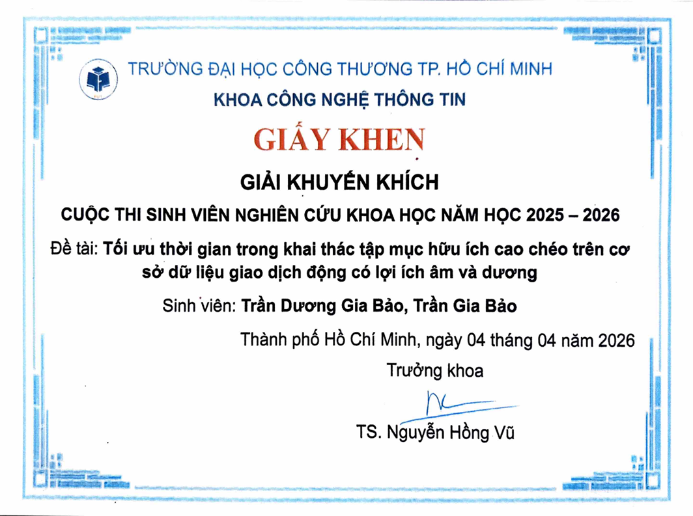
    </td>
    <td align="center" width="50%">
      <strong>Giấy chứng nhận Tham gia NCKH</strong><br/><br/>
      
    </td>
  </tr>
</table>

- **Đề tài:** *"Tối ưu hóa thời gian khai phá tập mục hữu ích cao trên cơ sở dữ liệu giao dịch có giá trị lợi nhuận dương và âm"*
- **Nhóm nghiên cứu:** Trần Dương Gia Bảo, Trần Gia Bảo
- **Cán bộ hướng dẫn:** ThS. Vũ Văn Vinh, HV. Phạm Tấn Thuận
- **Thời gian:** 04/04/2026
- **Mã nguồn:** [`HUIMiner`](https://github.com/Peo051/HUIMiner) &amp; [`CLHMiner`](https://github.com/Peo051/CLHMiner)

<p align="center">
  <em>Thực hiện đề tài nghiên cứu khoa học sinh viên tại Khoa Công nghệ Thông tin, Đại học Công Thương TP.HCM và đạt Giải Khuyến khích.</em>
</p>
</details>

---

### 📜 Chứng chỉ chuyên môn

<details>
<summary>🎓 <strong>Google AI Professional Certificate</strong> &nbsp;(Đã hoàn thành)</summary>
<br/>

- **Tổ chức cấp:** Google qua Coursera
- **Ngày cấp:** 20/04/2026
- **Xác thực:** [Verify Professional Certificate](https://coursera.org/verify/professional-cert/9477RZVHLC2N)
- **Tổng quan:** Chứng chỉ chuyên nghiệp bao quát nguyên lý AI nền tảng, kỹ thuật thiết kế câu lệnh (Prompting), trích xuất thông tin nghiên cứu, sáng tạo nội dung, phân tích dữ liệu và kiến trúc ứng dụng AI qua chuỗi 7 khóa học chuyên sâu.

<p align="center">
  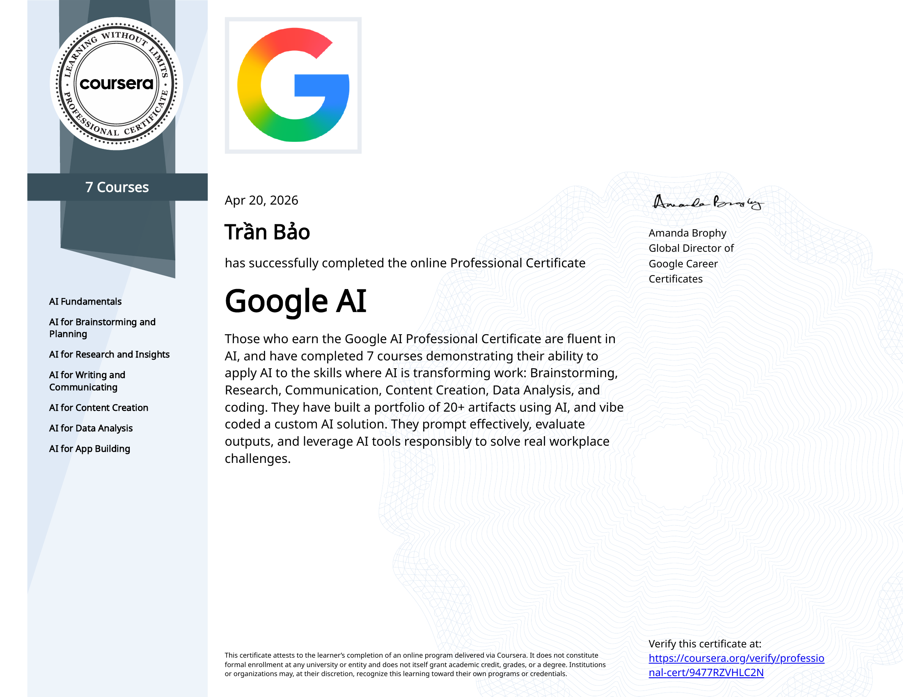
</p>

<details>
<summary>&nbsp;&nbsp;&nbsp;&nbsp;📚 <strong>Xem 7 chứng chỉ thành phần</strong></summary>
<br/>

<table width="100%">
  <tr>
    <td align="center" width="50%" valign="top">
      <strong>AI Fundamentals</strong><br/>
      <sub><a href="https://coursera.org/verify/LBBNAPKH73YU">Xác thực chứng chỉ</a></sub><br/><br/>
      
    </td>
    <td align="center" width="50%" valign="top">
      <strong>AI for Brainstorming and Planning</strong><br/>
      <sub><a href="https://coursera.org/verify/CXD4JWUUX6R1">Xác thực chứng chỉ</a></sub><br/><br/>
      
    </td>
  </tr>
  <tr>
    <td align="center" width="50%" valign="top">
      <strong>AI for Research and Insights</strong><br/>
      <sub><a href="https://coursera.org/verify/82WE4Y9VAF24">Xác thực chứng chỉ</a></sub><br/><br/>
      
    </td>
    <td align="center" width="50%" valign="top">
      <strong>AI for Writing and Communicating</strong><br/>
      <sub><a href="https://coursera.org/verify/Q1LLZP8ZJDZO">Xác thực chứng chỉ</a></sub><br/><br/>
      
    </td>
  </tr>
  <tr>
    <td align="center" width="50%" valign="top">
      <strong>AI for Content Creation</strong><br/>
      <sub><a href="https://coursera.org/verify/96M51QHX14HM">Xác thực chứng chỉ</a></sub><br/><br/>
      
    </td>
    <td align="center" width="50%" valign="top">
      <strong>AI for Data Analysis</strong><br/>
      <sub><a href="https://coursera.org/verify/0LYML214PN23">Xác thực chứng chỉ</a></sub><br/><br/>
      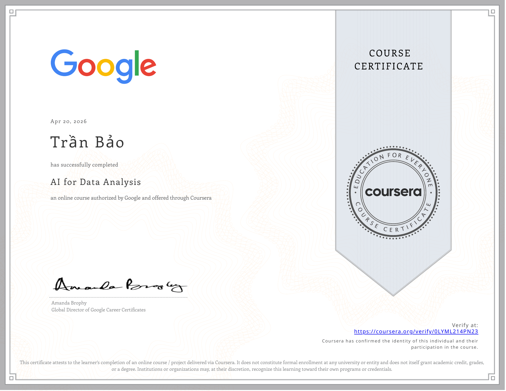
    </td>
  </tr>
  <tr>
    <td align="center" width="50%" valign="top">
      <strong>AI for App Building</strong><br/>
      <sub><a href="https://coursera.org/verify/5TKOALL9R78O">Xác thực chứng chỉ</a></sub><br/><br/>
      
    </td>
    <td align="center" width="50%" valign="top"></td>
  </tr>
</table>

</details>
</details>

<br/>

<details>
<summary>🎓 <strong>Google AI Essentials Specialization</strong> &nbsp;(Đã hoàn thành)</summary>
<br/>

- **Tổ chức cấp:** Google qua Coursera
- **Ngày cấp:** 24/04/2026
- **Xác thực:** [Verify Specialization](https://coursera.org/verify/specialization/OA4F9JXTDQV2)
- **Tổng quan:** Chuyên ngành thiết lập năng lực thực hành nền tảng với AI tạo sinh, tối ưu hóa quy trình làm việc, thiết kế câu lệnh (Prompting) và sử dụng AI có trách nhiệm.

<p align="center">
  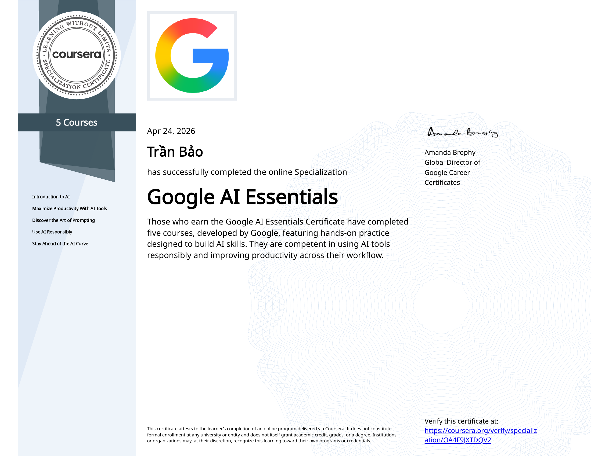
</p>

<details>
<summary>&nbsp;&nbsp;&nbsp;&nbsp;📚 <strong>Xem 5 chứng chỉ thành phần</strong></summary>
<br/>

<table width="100%">
  <tr>
    <td align="center" width="50%" valign="top">
      <strong>Introduction to AI</strong><br/>
      <sub><a href="https://coursera.org/verify/GGGCSVFYV6Z7">Xác thực chứng chỉ</a></sub><br/><br/>
      
    </td>
    <td align="center" width="50%" valign="top">
      <strong>Maximize Productivity With AI Tools</strong><br/>
      <sub><a href="https://coursera.org/verify/YLBW8IUHL2AT">Xác thực chứng chỉ</a></sub><br/><br/>
      
    </td>
  </tr>
  <tr>
    <td align="center" width="50%" valign="top">
      <strong>Discover the Art of Prompting</strong><br/>
      <sub><a href="https://coursera.org/verify/95K4US2N6RI4">Xác thực chứng chỉ</a></sub><br/><br/>
      
    </td>
    <td align="center" width="50%" valign="top">
      <strong>Use AI Responsibly</strong><br/>
      <sub><a href="https://coursera.org/verify/67U9FYD7X0F3">Xác thực chứng chỉ</a></sub><br/><br/>
      
    </td>
  </tr>
  <tr>
    <td align="center" width="50%" valign="top">
      <strong>Stay Ahead of the AI Curve</strong><br/>
      <sub><a href="https://coursera.org/verify/LAOTVMIOVCJW">Xác thực chứng chỉ</a></sub><br/><br/>
      
    </td>
    <td align="center" width="50%" valign="top"></td>
  </tr>
</table>

</details>
</details>

<br/>

<details>
<summary>🎓 <strong>Accelerate Your Job Search with AI Specialization</strong> &nbsp;(Đã hoàn thành)</summary>
<br/>

- **Tổ chức cấp:** Google qua Coursera
- **Ngày cấp:** 25/04/2026
- **Xác thực:** [Verify Specialization](https://coursera.org/verify/specialization/DM1GGN4MS6QF)
- **Tổng quan:** Chuyên ngành tối ưu hóa quy trình tìm việc hiện đại bằng AI: khai phá kỹ năng chuyển đổi, nghiên cứu thị trường nghề nghiệp, quản lý hồ sơ ứng tuyển và luyện tập phỏng vấn.

<p align="center">
  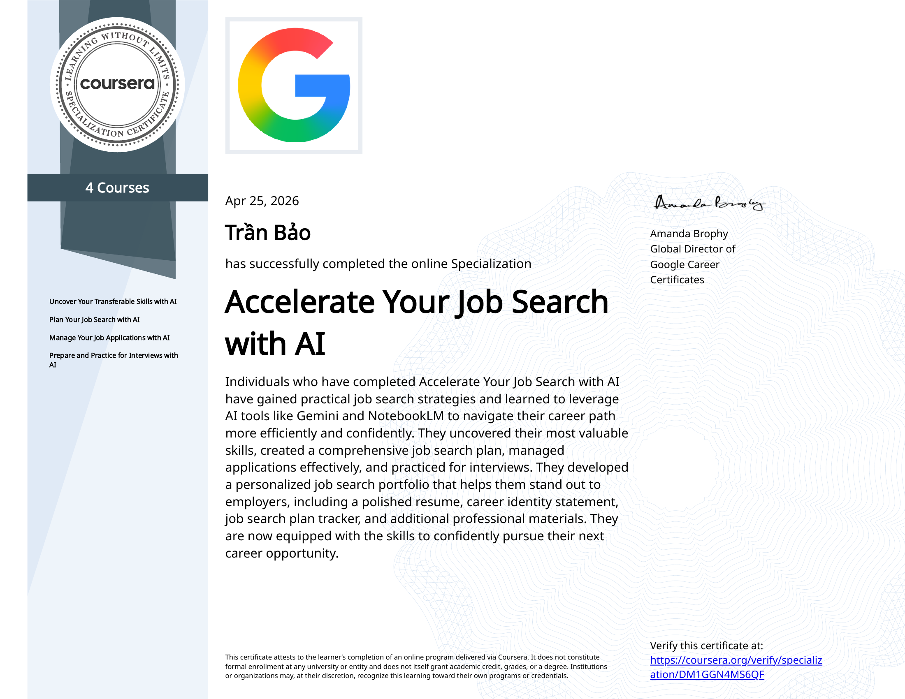
</p>

<details>
<summary>&nbsp;&nbsp;&nbsp;&nbsp;📚 <strong>Xem 4 chứng chỉ thành phần</strong></summary>
<br/>

<table width="100%">
  <tr>
    <td align="center" width="50%" valign="top">
      <strong>Uncover Your Transferable Skills with AI</strong><br/>
      <sub><a href="https://coursera.org/verify/BOXPIJ1FTNTO">Xác thực chứng chỉ</a></sub><br/><br/>
      
    </td>
    <td align="center" width="50%" valign="top">
      <strong>Plan Your Job Search with AI</strong><br/>
      <sub><a href="https://coursera.org/verify/4KVCJ4AEDZSB">Xác thực chứng chỉ</a></sub><br/><br/>
      
    </td>
  </tr>
  <tr>
    <td align="center" width="50%" valign="top">
      <strong>Manage Your Job Applications with AI</strong><br/>
      <sub><a href="https://coursera.org/verify/4EEKR5ME6QIY">Xác thực chứng chỉ</a></sub><br/><br/>
      
    </td>
    <td align="center" width="50%" valign="top">
      <strong>Prepare and Practice for Interviews with AI</strong><br/>
      <sub><a href="https://coursera.org/verify/RBQ3URO1UDZ5">Xác thực chứng chỉ</a></sub><br/><br/>
      
    </td>
  </tr>
</table>

</details>
</details>

<br/>

<details>
<summary>🎓 <strong>Google Prompting Essentials Specialization</strong> &nbsp;(Đã hoàn thành)</summary>
<br/>

- **Tổ chức cấp:** Google qua Coursera
- **Ngày cấp:** 25/04/2026
- **Xác thực:** [Verify Specialization](https://coursera.org/verify/specialization/L8HEWMHNUMWE)
- **Tổng quan:** Phương pháp thiết kế Prompt nâng cao cho các nghiệp vụ chuyên môn, tự động hóa phân tích dữ liệu, báo cáo thuyết trình và cộng tác hiệu quả cùng các mô hình AI.

<p align="center">
  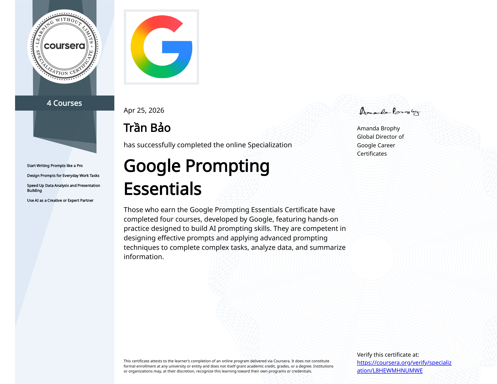
</p>

<details>
<summary>&nbsp;&nbsp;&nbsp;&nbsp;📚 <strong>Xem 4 chứng chỉ thành phần</strong></summary>
<br/>

<table width="100%">
  <tr>
    <td align="center" width="50%" valign="top">
      <strong>Start Writing Prompts like a Pro</strong><br/>
      <sub><a href="https://coursera.org/verify/7D7NHC7BYM89">Xác thực chứng chỉ</a></sub><br/><br/>
      
    </td>
    <td align="center" width="50%" valign="top">
      <strong>Design Prompts for Everyday Work Tasks</strong><br/>
      <sub><a href="https://coursera.org/verify/Z8XRRMSZD9A9">Xác thực chứng chỉ</a></sub><br/><br/>
      
    </td>
  </tr>
  <tr>
    <td align="center" width="50%" valign="top">
      <strong>Speed Up Data Analysis and Presentation Building</strong><br/>
      <sub><a href="https://coursera.org/verify/KEJ60APLHVJC">Xác thực chứng chỉ</a></sub><br/><br/>
      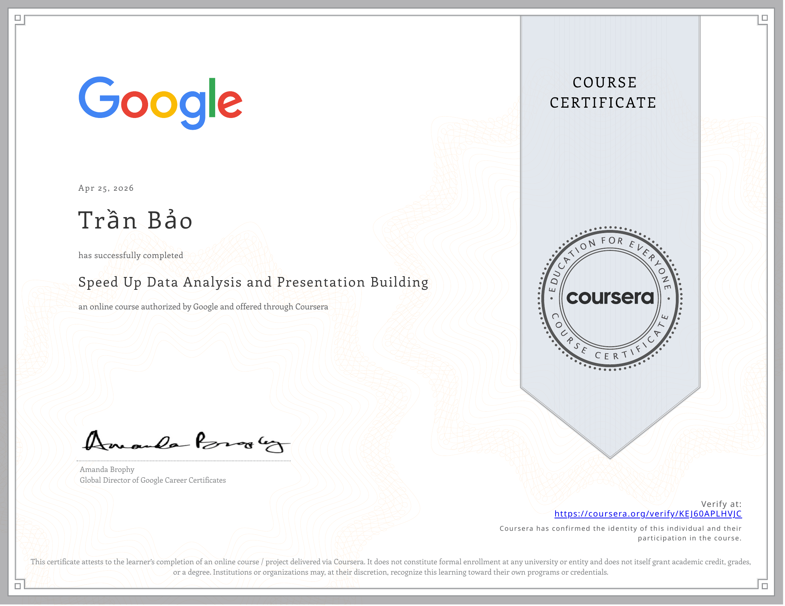
    </td>
    <td align="center" width="50%" valign="top">
      <strong>Use AI as a Creative or Expert Partner</strong><br/>
      <sub><a href="https://coursera.org/verify/XU8U2ROLZJ09">Xác thực chứng chỉ</a></sub><br/><br/>
      
    </td>
  </tr>
</table>

</details>
</details>

<br/>

<details>
<summary>🎓 <strong>Google UX Design Professional Certificate</strong> &nbsp;(Đã hoàn thành)</summary>
<br/>

- **Tổ chức cấp:** Google qua Coursera
- **Ngày cấp:** 25/04/2026
- **Xác thực:** [Verify Professional Certificate](https://coursera.org/verify/professional-cert/CO07OPHIC3ER)
- **Tổng quan:** Chương trình đào tạo toàn diện 8 khóa học về thiết kế trải nghiệm người dùng: nghiên cứu thấu cảm người dùng (Empathize), phác thảo khung dây (Wireframe), thiết kế mẫu thử độ chân thực cao (High-Fidelity Prototype) trên Figma, xây dựng giao diện tương tác động và chuẩn bị nghề nghiệp với AI.

<p align="center">
  
</p>

<details>
<summary>&nbsp;&nbsp;&nbsp;&nbsp;📚 <strong>Xem 8 chứng chỉ thành phần</strong></summary>
<br/>

<table width="100%">
  <tr>
    <td align="center" width="50%" valign="top">
      <strong>Foundations of User Experience (UX) Design</strong><br/>
      <sub><a href="https://coursera.org/verify/5ACPWD0XBD3W">Xác thực chứng chỉ</a></sub><br/><br/>
      
    </td>
    <td align="center" width="50%" valign="top">
      <strong>Start the UX Design Process: Empathize, Define, and Ideate</strong><br/>
      <sub><a href="https://coursera.org/verify/926MG2ZZPQEE">Xác thực chứng chỉ</a></sub><br/><br/>
      
    </td>
  </tr>
  <tr>
    <td align="center" width="50%" valign="top">
      <strong>Build Wireframes and Low-Fidelity Prototypes</strong><br/>
      <sub><a href="https://coursera.org/verify/NXO21IME4XM4">Xác thực chứng chỉ</a></sub><br/><br/>
      
    </td>
    <td align="center" width="50%" valign="top">
      <strong>Conduct UX Research and Test Early Concepts</strong><br/>
      <sub><a href="https://coursera.org/verify/Y4K2LKTMUPSV">Xác thực chứng chỉ</a></sub><br/><br/>
      
    </td>
  </tr>
  <tr>
    <td align="center" width="50%" valign="top">
      <strong>Create High-Fidelity Designs &amp; Prototypes in Figma</strong><br/>
      <sub><a href="https://coursera.org/verify/33K9GDA8MMPT">Xác thực chứng chỉ</a></sub><br/><br/>
      
    </td>
    <td align="center" width="50%" valign="top">
      <strong>Build Dynamic User Interfaces (UI) for Websites</strong><br/>
      <sub><a href="https://coursera.org/verify/DRQSN9BG2QL2">Xác thực chứng chỉ</a></sub><br/><br/>
      
    </td>
  </tr>
  <tr>
    <td align="center" width="50%" valign="top">
      <strong>Design a User Experience for Social Good &amp; Prepare for Jobs</strong><br/>
      <sub><a href="https://coursera.org/verify/B7WZ416MKODO">Xác thực chứng chỉ</a></sub><br/><br/>
      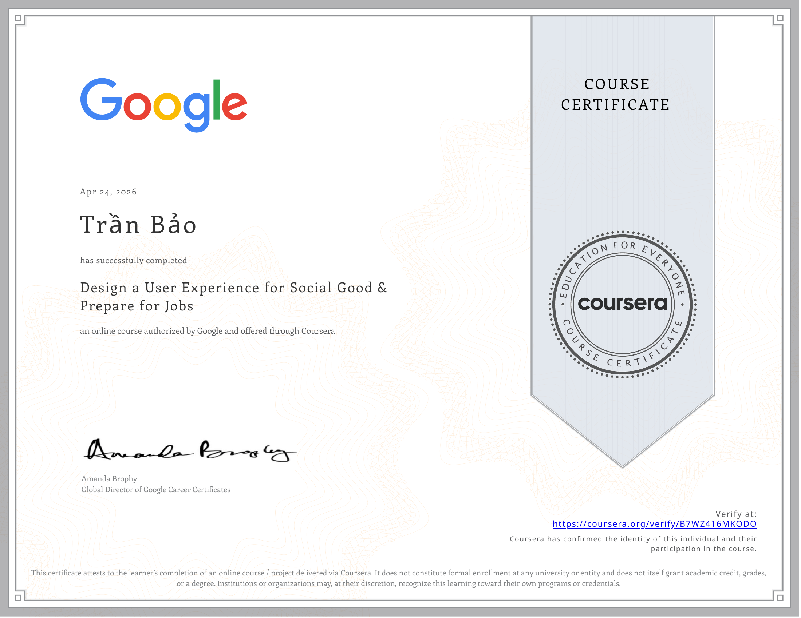
    </td>
    <td align="center" width="50%" valign="top">
      <strong>Accelerate Your Job Search with AI</strong><br/>
      <sub><a href="https://coursera.org/verify/GYOETDKLOOFO">Xác thực chứng chỉ</a></sub><br/><br/>
      
    </td>
  </tr>
</table>

</details>
</details>

<br/>

<details>
<summary>🎓 <strong>Google Data Analytics Professional Certificate</strong> &nbsp;(Đã hoàn thành)</summary>
<br/>

- **Tổ chức cấp:** Google qua Coursera
- **Ngày cấp:** 13/11/2026
- **Xác thực:** [Verify Professional Certificate](https://coursera.org/verify/professional-cert/FM7X7JSY9X7N)
- **Tổng quan:** Chương trình đào tạo 9 khóa học về phân tích dữ liệu: chuẩn bị và làm sạch dữ liệu, SQL, bảng tính, trực quan hóa bằng Tableau, phân tích dữ liệu với Python và dự án tổng kết.

<p align="center">
  
</p>

<details>
<summary>&nbsp;&nbsp;&nbsp;&nbsp;📚 <strong>Xem 9 chứng chỉ thành phần</strong></summary>
<br/>

<table width="100%">
  <tr>
    <td align="center" width="50%" valign="top">
      <strong>Foundations: Data, Data, Everywhere</strong><br/>
      <sub><a href="https://coursera.org/verify/V7XHPOUYIO46">Xác thực chứng chỉ</a></sub><br/><br/>
      
    </td>
    <td align="center" width="50%" valign="top">
      <strong>Ask Questions to Make Data-Driven Decisions</strong><br/>
      <sub><a href="https://coursera.org/verify/YWPTPGT3I2L0">Xác thực chứng chỉ</a></sub><br/><br/>
      
    </td>
  </tr>
  <tr>
    <td align="center" width="50%" valign="top">
      <strong>Prepare Data for Exploration</strong><br/>
      <sub><a href="https://coursera.org/verify/PEQM4MAT85Y1">Xác thực chứng chỉ</a></sub><br/><br/>
      
    </td>
    <td align="center" width="50%" valign="top">
      <strong>Process Data from Dirty to Clean</strong><br/>
      <sub><a href="https://coursera.org/verify/QBXBK8DO3WO1">Xác thực chứng chỉ</a></sub><br/><br/>
      
    </td>
  </tr>
  <tr>
    <td align="center" width="50%" valign="top">
      <strong>Analyze Data to Answer Questions</strong><br/>
      <sub><a href="https://coursera.org/verify/Q7X9IRA3J2HY">Xác thực chứng chỉ</a></sub><br/><br/>
      
    </td>
    <td align="center" width="50%" valign="top">
      <strong>Share Data Through the Art of Visualization</strong><br/>
      <sub><a href="https://coursera.org/verify/UYUVYEWFAMDZ">Xác thực chứng chỉ</a></sub><br/><br/>
      
    </td>
  </tr>
  <tr>
    <td align="center" width="50%" valign="top">
      <strong>Introduction to Data Analysis Using Python</strong><br/>
      <sub><a href="https://coursera.org/verify/W0TAIBSCTJON">Xác thực chứng chỉ</a></sub><br/><br/>
      
    </td>
    <td align="center" width="50%" valign="top">
      <strong>Google Data Analytics Capstone: Complete a Case Study</strong><br/>
      <sub><a href="https://coursera.org/verify/355OMIUHWCY">Xác thực chứng chỉ</a></sub><br/><br/>
      
    </td>
  </tr>
  <tr>
    <td align="center" width="50%" valign="top">
      <strong>Accelerate Your Job Search with AI</strong><br/>
      <sub><a href="https://coursera.org/verify/GYOETDKLOOFO">Xác thực chứng chỉ</a></sub><br/><br/>
      
    </td>
    <td align="center" width="50%" valign="top"></td>
  </tr>
</table>

</details>
</details>

<br/>

<details>
<summary>🎓 <strong>Google Advanced Data Analytics Professional Certificate</strong> &nbsp;(Đã hoàn thành)</summary>
<br/>

- **Tổ chức cấp:** Google qua Coursera
- **Ngày cấp:** 13/11/2026
- **Xác thực:** [Verify Professional Certificate](https://coursera.org/verify/professional-cert/833UEV1EEXWI)
- **Tổng quan:** Chương trình nâng cao 7 khóa học về khoa học dữ liệu và phân tích chuyên sâu: thống kê ứng dụng, phân tích hồi quy, học máy (Machine Learning) và mô hình dự báo.

<p align="center">
  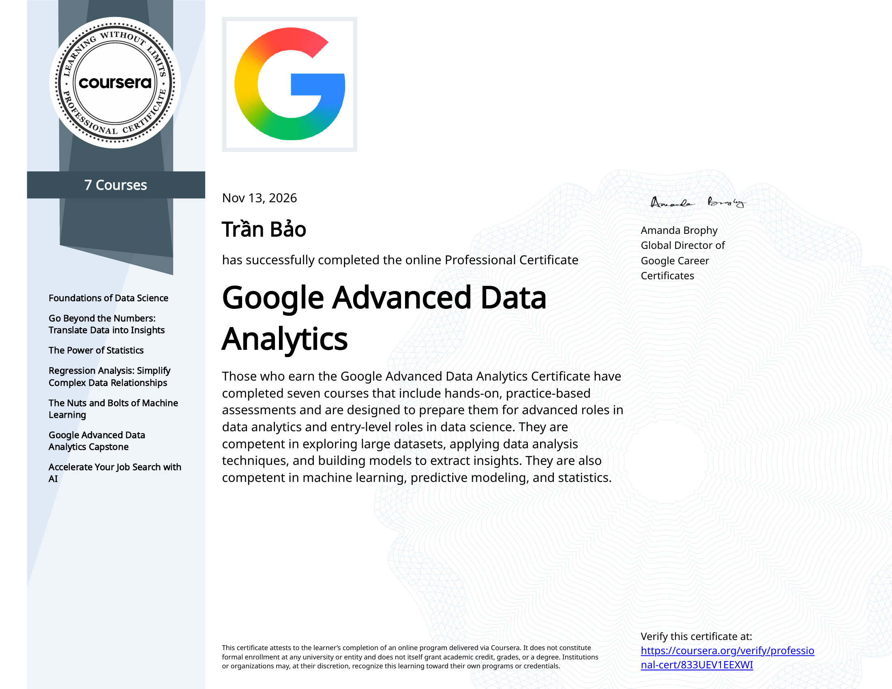
</p>

<details>
<summary>&nbsp;&nbsp;&nbsp;&nbsp;📚 <strong>Xem 7 chứng chỉ thành phần</strong></summary>
<br/>

<table width="100%">
  <tr>
    <td align="center" width="50%" valign="top">
      <strong>Foundations of Data Science</strong><br/>
      <sub><a href="https://coursera.org/verify/8FX0K3EEGUTY">Xác thực chứng chỉ</a></sub><br/><br/>
      
    </td>
    <td align="center" width="50%" valign="top">
      <strong>Go Beyond the Numbers: Translate Data into Insights</strong><br/>
      <sub><a href="https://coursera.org/verify/OF27EEKLL2S5">Xác thực chứng chỉ</a></sub><br/><br/>
      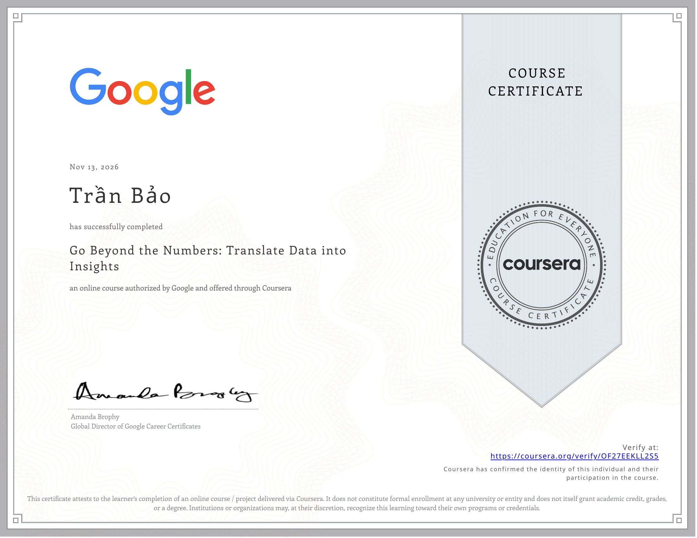
    </td>
  </tr>
  <tr>
    <td align="center" width="50%" valign="top">
      <strong>The Power of Statistics</strong><br/>
      <sub><a href="https://coursera.org/verify/LHY16EIFUE4I">Xác thực chứng chỉ</a></sub><br/><br/>
      
    </td>
    <td align="center" width="50%" valign="top">
      <strong>Regression Analysis: Simplify Complex Data Relationships</strong><br/>
      <sub><a href="https://coursera.org/verify/HK6S1UCOG5QL">Xác thực chứng chỉ</a></sub><br/><br/>
      
    </td>
  </tr>
  <tr>
    <td align="center" width="50%" valign="top">
      <strong>The Nuts and Bolts of Machine Learning</strong><br/>
      <sub><a href="https://coursera.org/verify/B9RGCPT68Q8T">Xác thực chứng chỉ</a></sub><br/><br/>
      
    </td>
    <td align="center" width="50%" valign="top">
      <strong>Google Advanced Data Analytics Capstone</strong><br/>
      <sub><a href="https://coursera.org/verify/170BWE2VIAPM">Xác thực chứng chỉ</a></sub><br/><br/>
      
    </td>
  </tr>
  <tr>
    <td align="center" width="50%" valign="top">
      <strong>Accelerate Your Job Search with AI</strong><br/>
      <sub><a href="https://coursera.org/verify/GYOETDKLOOFO">Xác thực chứng chỉ</a></sub><br/><br/>
      
    </td>
    <td align="center" width="50%" valign="top"></td>
  </tr>
</table>

</details>
</details>

<br/>

<details>
<summary>🎓 <strong>Google Business Intelligence Professional Certificate</strong> &nbsp;(Đã hoàn thành)</summary>
<br/>

- **Tổ chức cấp:** Google qua Coursera
- **Ngày cấp:** 13/11/2026
- **Xác thực:** [Verify Professional Certificate](https://coursera.org/verify/professional-cert/Q9ORJ0ZTRT74)
- **Tổng quan:** Chứng chỉ chuyên nghiệp 4 khóa học tập trung vào thiết kế mô hình dữ liệu BI, luồng xử lý dữ liệu (Pipelines), xây dựng bảng điều khiển (Dashboards) và báo cáo hỗ trợ ra quyết định.

<p align="center">
  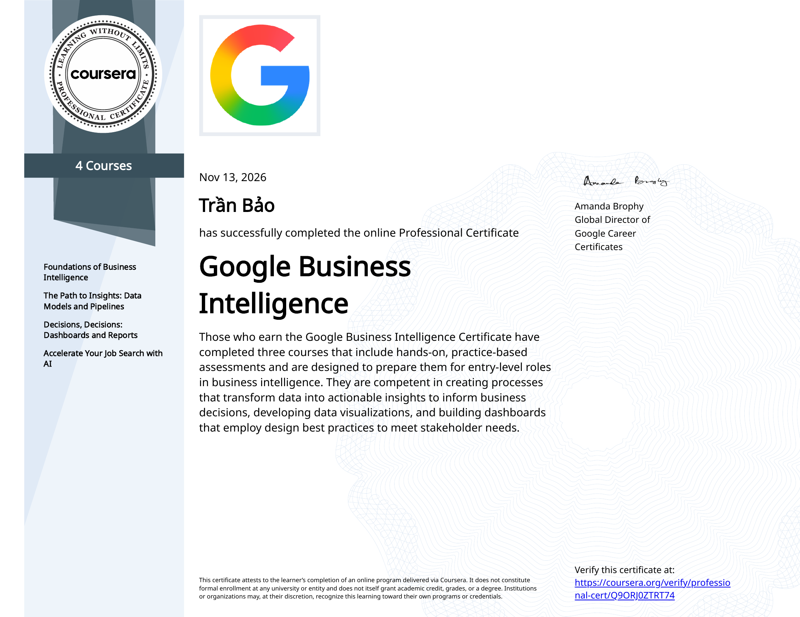
</p>

<details>
<summary>&nbsp;&nbsp;&nbsp;&nbsp;📚 <strong>Xem 4 chứng chỉ thành phần</strong></summary>
<br/>

<table width="100%">
  <tr>
    <td align="center" width="50%" valign="top">
      <strong>Foundations of Business Intelligence</strong><br/>
      <sub><a href="https://coursera.org/verify/LT5YNQ53Q7O0">Xác thực chứng chỉ</a></sub><br/><br/>
      
    </td>
    <td align="center" width="50%" valign="top">
      <strong>The Path to Insights: Data Models and Pipelines</strong><br/>
      <sub><a href="https://coursera.org/verify/235QUNKD0RI2">Xác thực chứng chỉ</a></sub><br/><br/>
      
    </td>
  </tr>
  <tr>
    <td align="center" width="50%" valign="top">
      <strong>Decisions, Decisions: Dashboards and Reports</strong><br/>
      <sub><a href="https://coursera.org/verify/G2M8CT3DQ1H5">Xác thực chứng chỉ</a></sub><br/><br/>
      
    </td>
    <td align="center" width="50%" valign="top">
      <strong>Accelerate Your Job Search with AI</strong><br/>
      <sub><a href="https://coursera.org/verify/GYOETDKLOOFO">Xác thực chứng chỉ</a></sub><br/><br/>
      
    </td>
  </tr>
</table>

</details>
</details>

<br/>

<details>
<summary>🎓 <strong>Google Data Analysis with Python Specialization</strong> &nbsp;(Đã hoàn thành)</summary>
<br/>

- **Tổ chức cấp:** Google qua Coursera
- **Ngày cấp:** 12/11/2026
- **Xác thực:** [Verify Specialization](https://coursera.org/verify/specialization/NFRV9P8OER0U)
- **Tổng quan:** Chuyên ngành 6 khóa học xây dựng năng lực lập trình Python, cấu trúc dữ liệu, NumPy, pandas, Jupyter Notebooks, phân tích khám phá và làm sạch dữ liệu thực tế.

<p align="center">
  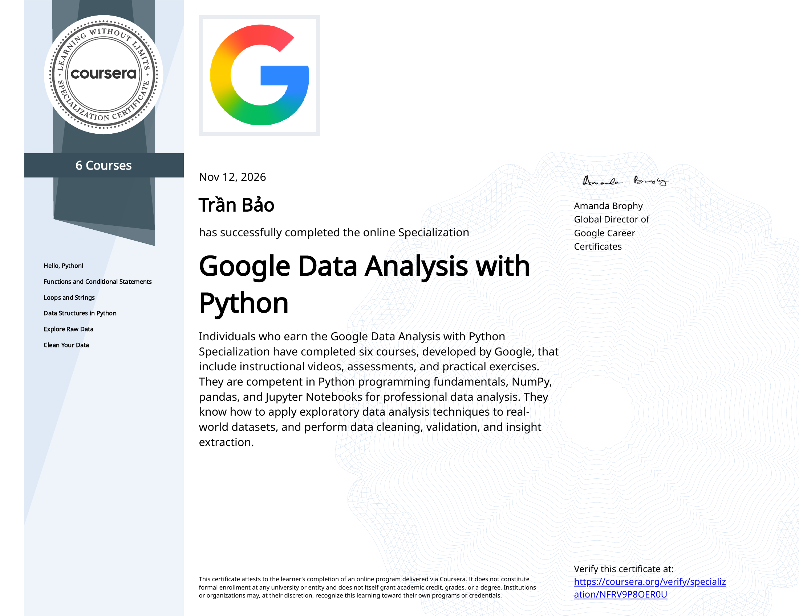
</p>

<details>
<summary>&nbsp;&nbsp;&nbsp;&nbsp;📚 <strong>Xem 6 chứng chỉ thành phần</strong></summary>
<br/>

<table width="100%">
  <tr>
    <td align="center" width="50%" valign="top">
      <strong>Hello, Python!</strong><br/>
      <sub><a href="https://coursera.org/verify/3DNY4Y9JTZP1">Xác thực chứng chỉ</a></sub><br/><br/>
      
    </td>
    <td align="center" width="50%" valign="top">
      <strong>Functions and Conditional Statements</strong><br/>
      <sub><a href="https://coursera.org/verify/8JAYGLXF8DOU">Xác thực chứng chỉ</a></sub><br/><br/>
      
    </td>
  </tr>
  <tr>
    <td align="center" width="50%" valign="top">
      <strong>Loops and Strings</strong><br/>
      <sub><a href="https://coursera.org/verify/5EQ0YG720ZMB">Xác thực chứng chỉ</a></sub><br/><br/>
      
    </td>
    <td align="center" width="50%" valign="top">
      <strong>Data Structures in Python</strong><br/>
      <sub><a href="https://coursera.org/verify/1AHU2UQNAN46">Xác thực chứng chỉ</a></sub><br/><br/>
      
    </td>
  </tr>
  <tr>
    <td align="center" width="50%" valign="top">
      <strong>Explore Raw Data</strong><br/>
      <sub><a href="https://coursera.org/verify/O3S58IAOEIGS">Xác thực chứng chỉ</a></sub><br/><br/>
      
    </td>
    <td align="center" width="50%" valign="top">
      <strong>Clean Your Data</strong><br/>
      <sub><a href="https://coursera.org/verify/8679HN59YFAN">Xác thực chứng chỉ</a></sub><br/><br/>
      
    </td>
  </tr>
</table>

</details>
</details>

<br/>

<details>
<summary>🎓 <strong>Google Data-Driven Decision Making Specialization</strong> &nbsp;(Đã hoàn thành)</summary>
<br/>

- **Tổ chức cấp:** Google qua Coursera
- **Ngày cấp:** 13/11/2026
- **Xác thực:** [Verify Specialization](https://coursera.org/verify/specialization/1ZP1AMMLFOYU)
- **Tổng quan:** Chuyên ngành 9 khóa học về tư duy phân tích, trách nhiệm và tính toàn vẹn dữ liệu, trực quan hóa, xây dựng thuyết trình và ứng dụng AI tăng tốc phân tích dữ liệu.

<p align="center">
  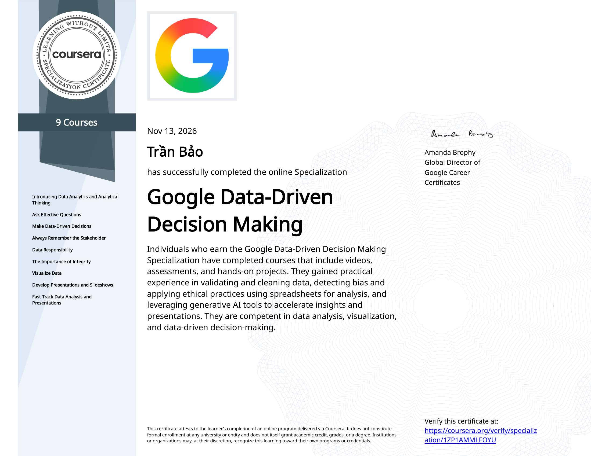
</p>

<details>
<summary>&nbsp;&nbsp;&nbsp;&nbsp;📚 <strong>Xem 9 chứng chỉ thành phần</strong></summary>
<br/>

<table width="100%">
  <tr>
    <td align="center" width="50%" valign="top">
      <strong>Introducing Data Analytics and Analytical Thinking</strong><br/>
      <sub><a href="https://coursera.org/verify/C1TOCJH3327J">Xác thực chứng chỉ</a></sub><br/><br/>
      
    </td>
    <td align="center" width="50%" valign="top">
      <strong>Ask Effective Questions</strong><br/>
      <sub><a href="https://coursera.org/verify/6DHLK4915HYF">Xác thực chứng chỉ</a></sub><br/><br/>
      
    </td>
  </tr>
  <tr>
    <td align="center" width="50%" valign="top">
      <strong>Always Remember the Stakeholder</strong><br/>
      <sub><a href="https://coursera.org/verify/N757AML2RJJE">Xác thực chứng chỉ</a></sub><br/><br/>
      
    </td>
    <td align="center" width="50%" valign="top">
      <strong>Make Data-Driven Decisions</strong><br/>
      <sub><a href="https://coursera.org/verify/PNIUAXGKK0MF">Xác thực chứng chỉ</a></sub><br/><br/>
      
    </td>
  </tr>
  <tr>
    <td align="center" width="50%" valign="top">
      <strong>Data Responsibility</strong><br/>
      <sub><a href="https://coursera.org/verify/LF8NLGVN6O3C">Xác thực chứng chỉ</a></sub><br/><br/>
      
    </td>
    <td align="center" width="50%" valign="top">
      <strong>The Importance of Integrity</strong><br/>
      <sub><a href="https://coursera.org/verify/BNN7AE4BYROR">Xác thực chứng chỉ</a></sub><br/><br/>
      
    </td>
  </tr>
  <tr>
    <td align="center" width="50%" valign="top">
      <strong>Visualize Data</strong><br/>
      <sub><a href="https://coursera.org/verify/BOHFKPUPZR8J">Xác thực chứng chỉ</a></sub><br/><br/>
      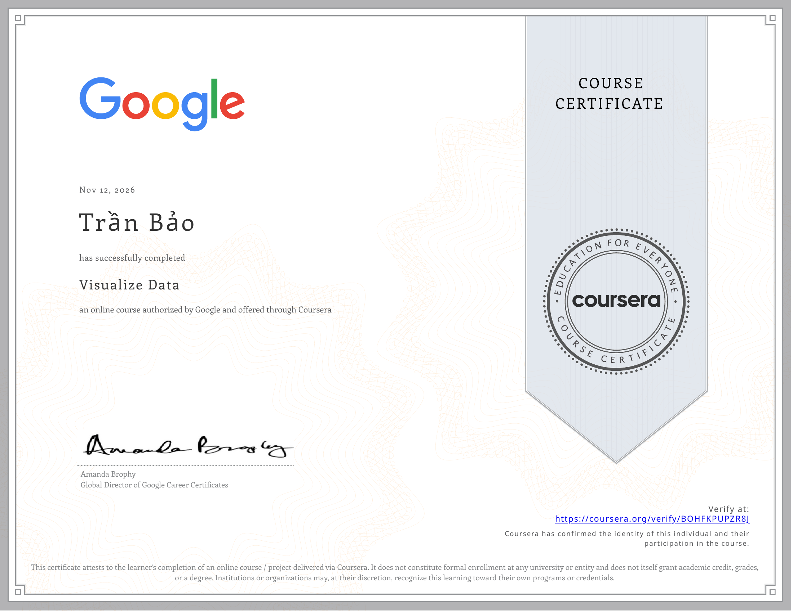
    </td>
    <td align="center" width="50%" valign="top">
      <strong>Develop Presentations and Slideshows</strong><br/>
      <sub><a href="https://coursera.org/verify/EEUHHM4ZCQTO">Xác thực chứng chỉ</a></sub><br/><br/>
      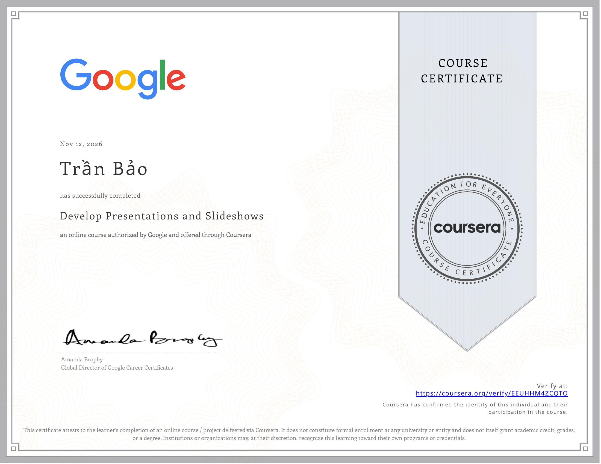
    </td>
  </tr>
  <tr>
    <td align="center" width="50%" valign="top">
      <strong>Fast-Track Data Analysis and Presentations</strong><br/>
      <sub><a href="https://coursera.org/verify/E257U5RBOKMF">Xác thực chứng chỉ</a></sub><br/><br/>
      
    </td>
    <td align="center" width="50%" valign="top"></td>
  </tr>
</table>

</details>
</details>

<br/>

<details>
<summary>🎓 <strong>Google Cybersecurity Professional Certificate</strong> &nbsp;(Đã hoàn thành)</summary>
<br/>

- **Tổ chức cấp:** Google qua Coursera
- **Ngày cấp:** 13/11/2026
- **Xác thực:** [Verify Professional Certificate](https://coursera.org/verify/professional-cert/9UWJUFNXMGU7)
- **Tổng quan:** Chương trình đào tạo 9 khóa học về an ninh mạng: quản trị rủi ro, bảo mật mạng, Linux, SQL, công cụ SIEM, hệ thống phát hiện xâm nhập (IDS) và tự động hóa tác vụ bảo mật bằng Python.

<p align="center">
  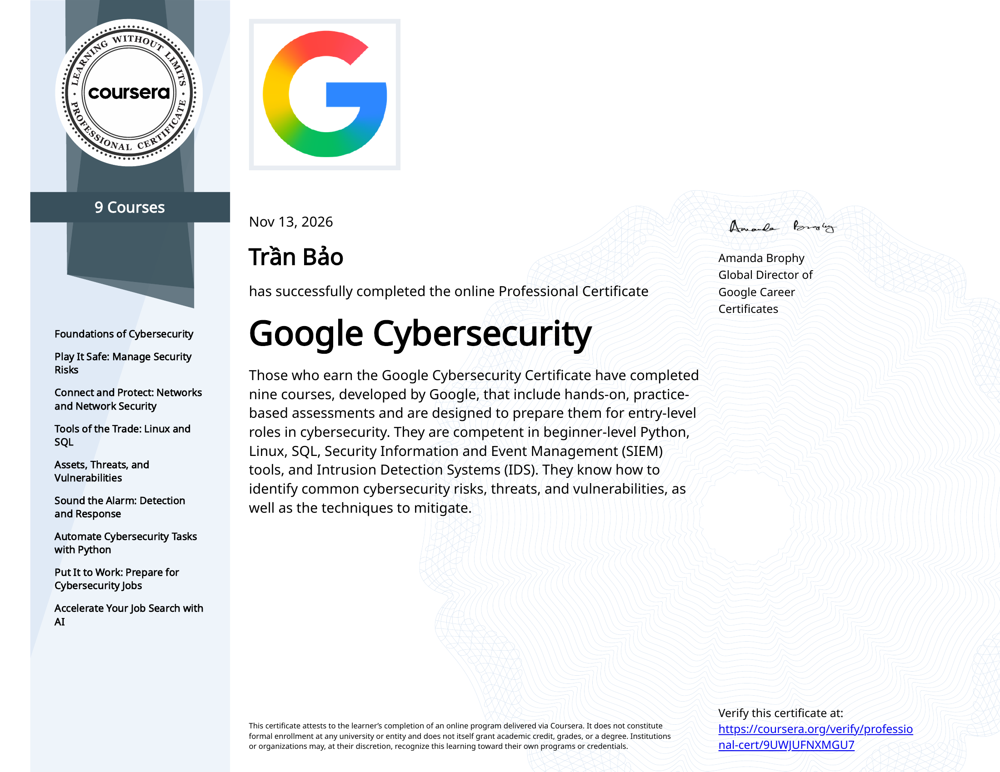
</p>

<details>
<summary>&nbsp;&nbsp;&nbsp;&nbsp;📚 <strong>Xem 9 chứng chỉ thành phần</strong></summary>
<br/>

<table width="100%">
  <tr>
    <td align="center" width="50%" valign="top">
      <strong>Foundations of Cybersecurity</strong><br/>
      <sub><a href="https://coursera.org/verify/T20K6XVS4RTA">Xác thực chứng chỉ</a></sub><br/><br/>
      
    </td>
    <td align="center" width="50%" valign="top">
      <strong>Play It Safe: Manage Security Risks</strong><br/>
      <sub><a href="https://coursera.org/verify/00NXOKH3F7CD">Xác thực chứng chỉ</a></sub><br/><br/>
      
    </td>
  </tr>
  <tr>
    <td align="center" width="50%" valign="top">
      <strong>Connect and Protect: Networks and Network Security</strong><br/>
      <sub><a href="https://coursera.org/verify/U7PWCSLN5BXO">Xác thực chứng chỉ</a></sub><br/><br/>
      
    </td>
    <td align="center" width="50%" valign="top">
      <strong>Tools of the Trade: Linux and SQL</strong><br/>
      <sub><a href="https://coursera.org/verify/NSAMFIBNIZ1U">Xác thực chứng chỉ</a></sub><br/><br/>
      
    </td>
  </tr>
  <tr>
    <td align="center" width="50%" valign="top">
      <strong>Assets, Threats, and Vulnerabilities</strong><br/>
      <sub><a href="https://coursera.org/verify/XBSV56N8R8ZW">Xác thực chứng chỉ</a></sub><br/><br/>
      
    </td>
    <td align="center" width="50%" valign="top">
      <strong>Sound the Alarm: Detection and Response</strong><br/>
      <sub><a href="https://coursera.org/verify/H8EJUBDCNK8D">Xác thực chứng chỉ</a></sub><br/><br/>
      
    </td>
  </tr>
  <tr>
    <td align="center" width="50%" valign="top">
      <strong>Automate Cybersecurity Tasks with Python</strong><br/>
      <sub><a href="https://coursera.org/verify/73SYSHCXLCKT">Xác thực chứng chỉ</a></sub><br/><br/>
      
    </td>
    <td align="center" width="50%" valign="top">
      <strong>Put It to Work: Prepare for Cybersecurity Jobs</strong><br/>
      <sub><a href="https://coursera.org/verify/BZD82F5FTIS8">Xác thực chứng chỉ</a></sub><br/><br/>
      
    </td>
  </tr>
  <tr>
    <td align="center" width="50%" valign="top">
      <strong>Accelerate Your Job Search with AI</strong><br/>
      <sub><a href="https://coursera.org/verify/GYOETDKLOOFO">Xác thực chứng chỉ</a></sub><br/><br/>
      
    </td>
    <td align="center" width="50%" valign="top"></td>
  </tr>
</table>

</details>
</details>

<br/>

<details>
<summary>🎓 <strong>Google IT Support Professional Certificate</strong> &nbsp;(Đã hoàn thành)</summary>
<br/>

- **Tổ chức cấp:** Google qua Coursera
- **Ngày cấp:** 13/11/2026
- **Xác thực:** [Verify Professional Certificate](https://coursera.org/verify/professional-cert/AZWBFV4V1UKM)
- **Tổng quan:** Chương trình 6 khóa học về hỗ trợ CNTT: chẩn đoán sự cố, mạng máy tính, hệ điều hành, quản trị hệ thống, dịch vụ hạ tầng CNTT và bảo mật hệ thống.

<p align="center">
  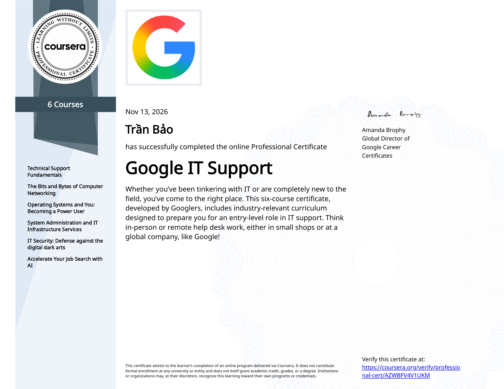
</p>

<details>
<summary>&nbsp;&nbsp;&nbsp;&nbsp;📚 <strong>Xem 6 chứng chỉ thành phần</strong></summary>
<br/>

<table width="100%">
  <tr>
    <td align="center" width="50%" valign="top">
      <strong>Technical Support Fundamentals</strong><br/>
      <sub><a href="https://coursera.org/verify/NS73Z7UUYSL7">Xác thực chứng chỉ</a></sub><br/><br/>
      
    </td>
    <td align="center" width="50%" valign="top">
      <strong>The Bits and Bytes of Computer Networking</strong><br/>
      <sub><a href="https://coursera.org/verify/6WPUDS6S49RO">Xác thực chứng chỉ</a></sub><br/><br/>
      
    </td>
  </tr>
  <tr>
    <td align="center" width="50%" valign="top">
      <strong>Operating Systems and You: Becoming a Power User</strong><br/>
      <sub><a href="https://coursera.org/verify/4V0XKDPRP8I7">Xác thực chứng chỉ</a></sub><br/><br/>
      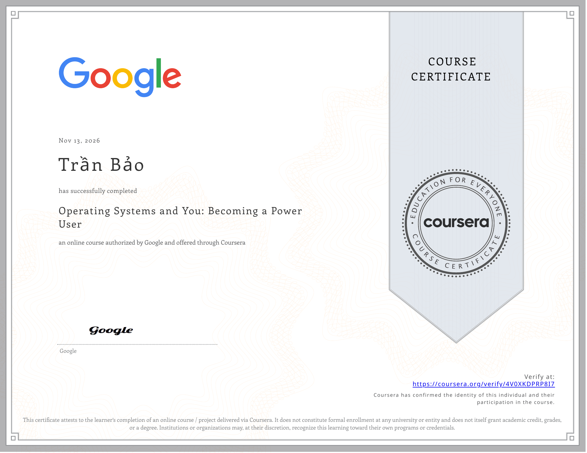
    </td>
    <td align="center" width="50%" valign="top">
      <strong>System Administration and IT Infrastructure Services</strong><br/>
      <sub><a href="https://coursera.org/verify/W12CAJJ5PSM2">Xác thực chứng chỉ</a></sub><br/><br/>
      
    </td>
  </tr>
  <tr>
    <td align="center" width="50%" valign="top">
      <strong>IT Security: Defense against the digital dark arts</strong><br/>
      <sub><a href="https://coursera.org/verify/HXKKN1QXETVK">Xác thực chứng chỉ</a></sub><br/><br/>
      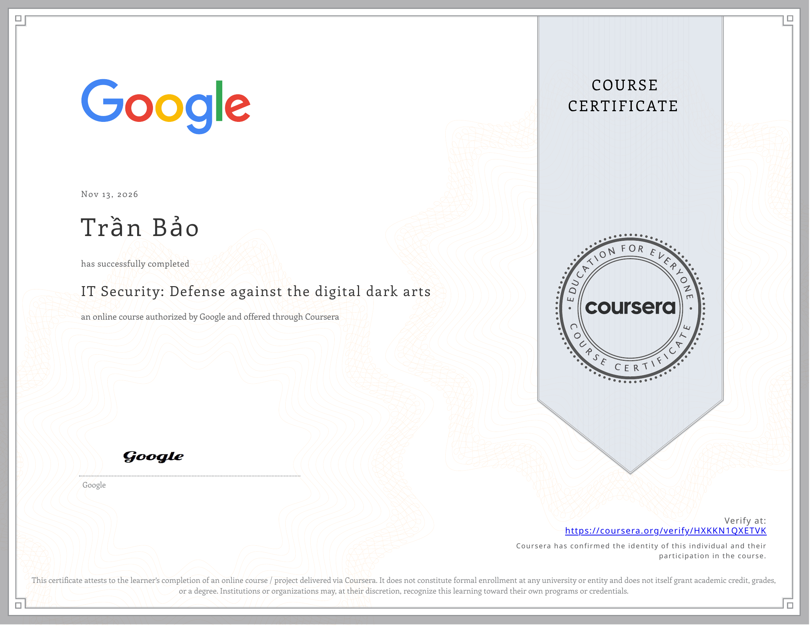
    </td>
    <td align="center" width="50%" valign="top">
      <strong>Accelerate Your Job Search with AI</strong><br/>
      <sub><a href="https://coursera.org/verify/GYOETDKLOOFO">Xác thực chứng chỉ</a></sub><br/><br/>
      
    </td>
  </tr>
</table>

</details>
</details>

<br/>

<details>
<summary>🎓 <strong>Google IT Automation with Python Professional Certificate</strong> &nbsp;(Đã hoàn thành)</summary>
<br/>

- **Tổ chức cấp:** Google qua Coursera
- **Ngày cấp:** 13/11/2026
- **Xác thực:** [Verify Professional Certificate](https://coursera.org/verify/professional-cert/05WZME20WSVU)
- **Tổng quan:** Chương trình 7 khóa học về tự động hóa CNTT với Python: lập trình Python, tương tác hệ điều hành, Git & GitHub, gỡ lỗi hệ thống, quản lý cấu hình đám mây và tự động hóa tác vụ.

<p align="center">
  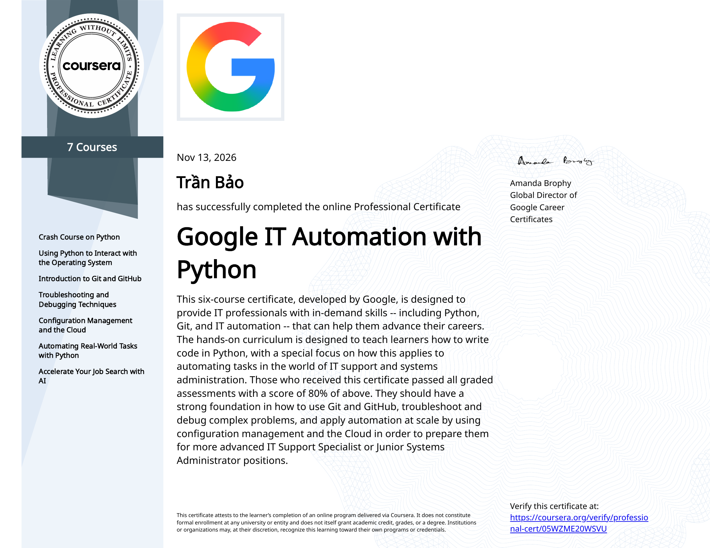
</p>

<details>
<summary>&nbsp;&nbsp;&nbsp;&nbsp;📚 <strong>Xem 7 chứng chỉ thành phần</strong></summary>
<br/>

<table width="100%">
  <tr>
    <td align="center" width="50%" valign="top">
      <strong>Crash Course on Python</strong><br/>
      <sub><a href="https://coursera.org/verify/BSE4U0H8B08N">Xác thực chứng chỉ</a></sub><br/><br/>
      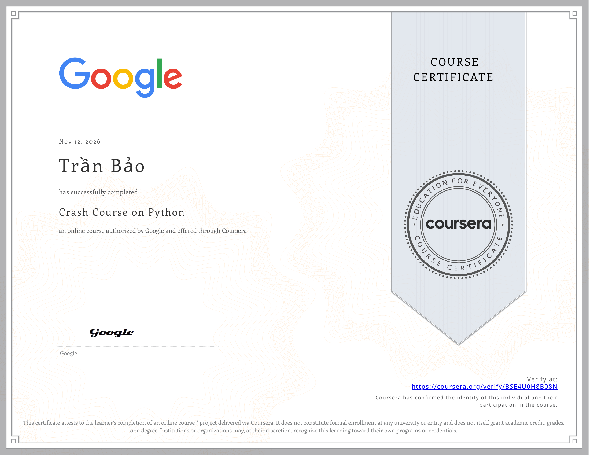
    </td>
    <td align="center" width="50%" valign="top">
      <strong>Using Python to Interact with the Operating System</strong><br/>
      <sub><a href="https://coursera.org/verify/5UVGEH5K5Z3F">Xác thực chứng chỉ</a></sub><br/><br/>
      
    </td>
  </tr>
  <tr>
    <td align="center" width="50%" valign="top">
      <strong>Introduction to Git and GitHub</strong><br/>
      <sub><a href="https://coursera.org/verify/5UE3UDE7FKDN">Xác thực chứng chỉ</a></sub><br/><br/>
      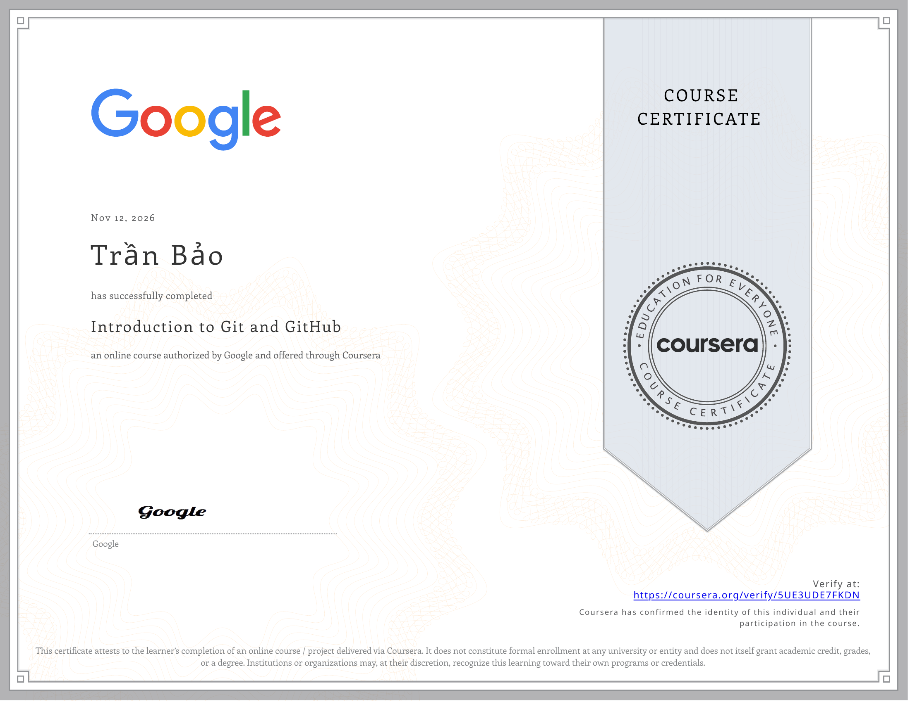
    </td>
    <td align="center" width="50%" valign="top">
      <strong>Troubleshooting and Debugging Techniques</strong><br/>
      <sub><a href="https://coursera.org/verify/UJFKU38NWFDC">Xác thực chứng chỉ</a></sub><br/><br/>
      
    </td>
  </tr>
  <tr>
    <td align="center" width="50%" valign="top">
      <strong>Configuration Management and the Cloud</strong><br/>
      <sub><a href="https://coursera.org/verify/4GSZ3MGDETBC">Xác thực chứng chỉ</a></sub><br/><br/>
      
    </td>
    <td align="center" width="50%" valign="top">
      <strong>Automating Real-World Tasks with Python</strong><br/>
      <sub><a href="https://coursera.org/verify/EGF3IM66WIPT">Xác thực chứng chỉ</a></sub><br/><br/>
      
    </td>
  </tr>
  <tr>
    <td align="center" width="50%" valign="top">
      <strong>Accelerate Your Job Search with AI</strong><br/>
      <sub><a href="https://coursera.org/verify/GYOETDKLOOFO">Xác thực chứng chỉ</a></sub><br/><br/>
      
    </td>
    <td align="center" width="50%" valign="top"></td>
  </tr>
</table>

</details>
</details>

<br/>

<details>
<summary>🎓 <strong>Google Project Management Professional Certificate</strong> &nbsp;(Đã hoàn thành)</summary>
<br/>

- **Tổ chức cấp:** Google qua Coursera
- **Ngày cấp:** 13/11/2026
- **Xác thực:** [Verify Professional Certificate](https://coursera.org/verify/professional-cert/NH44VV78F2B7)
- **Tổng quan:** Chương trình 7 khóa học về quản trị dự án: khởi tạo, lập kế hoạch, triển khai vận hành, quản trị rủi ro, phương pháp Agile và dự án thực tế.

<p align="center">
  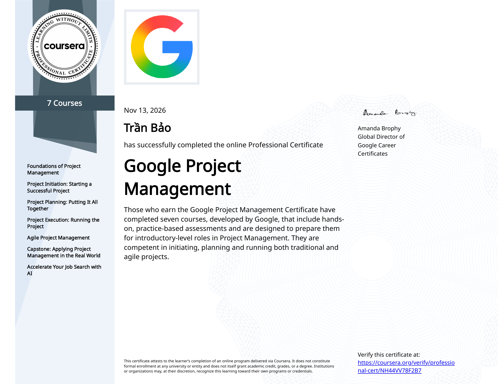
</p>

<details>
<summary>&nbsp;&nbsp;&nbsp;&nbsp;📚 <strong>Xem 7 chứng chỉ thành phần</strong></summary>
<br/>

<table width="100%">
  <tr>
    <td align="center" width="50%" valign="top">
      <strong>Foundations of Project Management</strong><br/>
      <sub><a href="https://coursera.org/verify/XLZG1AYONQ02">Xác thực chứng chỉ</a></sub><br/><br/>
      
    </td>
    <td align="center" width="50%" valign="top">
      <strong>Project Initiation: Starting a Successful Project</strong><br/>
      <sub><a href="https://coursera.org/verify/JQ4MPIXANBL3">Xác thực chứng chỉ</a></sub><br/><br/>
      
    </td>
  </tr>
  <tr>
    <td align="center" width="50%" valign="top">
      <strong>Project Planning: Putting It All Together</strong><br/>
      <sub><a href="https://coursera.org/verify/II6AXM71ULSV">Xác thực chứng chỉ</a></sub><br/><br/>
      
    </td>
    <td align="center" width="50%" valign="top">
      <strong>Project Execution: Running the Project</strong><br/>
      <sub><a href="https://coursera.org/verify/VYXQ7AO6CAZB">Xác thực chứng chỉ</a></sub><br/><br/>
      
    </td>
  </tr>
  <tr>
    <td align="center" width="50%" valign="top">
      <strong>Agile Project Management</strong><br/>
      <sub><a href="https://coursera.org/verify/P178HOLJMROW">Xác thực chứng chỉ</a></sub><br/><br/>
      
    </td>
    <td align="center" width="50%" valign="top">
      <strong>Capstone: Applying Project Management in the Real World</strong><br/>
      <sub><a href="https://coursera.org/verify/SYU3CFLD0SUA">Xác thực chứng chỉ</a></sub><br/><br/>
      
    </td>
  </tr>
  <tr>
    <td align="center" width="50%" valign="top">
      <strong>Accelerate Your Job Search with AI</strong><br/>
      <sub><a href="https://coursera.org/verify/GYOETDKLOOFO">Xác thực chứng chỉ</a></sub><br/><br/>
      
    </td>
    <td align="center" width="50%" valign="top"></td>
  </tr>
</table>

</details>
</details>

<br/>

<details>
<summary>🎓 <strong>Google Agile Essentials Specialization</strong> &nbsp;(Đã hoàn thành)</summary>
<br/>

- **Tổ chức cấp:** Google qua Coursera
- **Ngày cấp:** 13/11/2026
- **Xác thực:** [Verify Specialization](https://coursera.org/verify/specialization/J85Z0EE86MU1)
- **Tổng quan:** Chuyên ngành 3 khóa học tập trung vào phương pháp luận Agile, triển khai khung làm việc Scrum, quản lý backlog, lập kế hoạch sprint và đo lường hiệu suất đội nhóm.

<p align="center">
  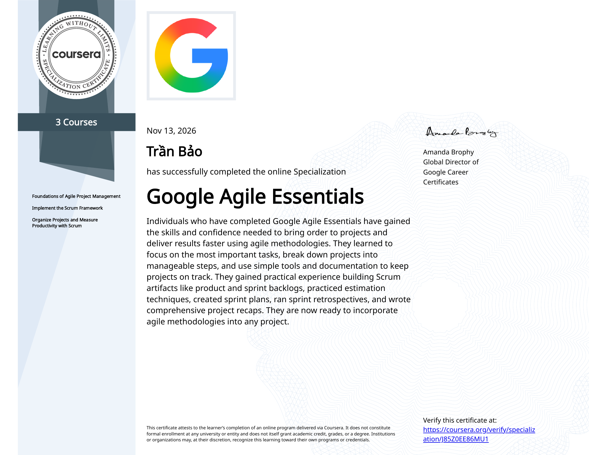
</p>

<details>
<summary>&nbsp;&nbsp;&nbsp;&nbsp;📚 <strong>Xem 3 chứng chỉ thành phần</strong></summary>
<br/>

<table width="100%">
  <tr>
    <td align="center" width="50%" valign="top">
      <strong>Foundations of Agile Project Management</strong><br/>
      <sub><a href="https://coursera.org/verify/KOSPFIK9O8GK">Xác thực chứng chỉ</a></sub><br/><br/>
      
    </td>
    <td align="center" width="50%" valign="top">
      <strong>Implement the Scrum Framework</strong><br/>
      <sub><a href="https://coursera.org/verify/VT8LX4X3NTVV">Xác thực chứng chỉ</a></sub><br/><br/>
      
    </td>
  </tr>
  <tr>
    <td align="center" width="50%" valign="top">
      <strong>Organize Projects and Measure Productivity with Scrum</strong><br/>
      <sub><a href="https://coursera.org/verify/7C13SWNRD9DY">Xác thực chứng chỉ</a></sub><br/><br/>
      
    </td>
    <td align="center" width="50%" valign="top"></td>
  </tr>
</table>

</details>
</details>

<br/>

<details>
<summary>🎓 <strong>Google Stakeholder Management Specialization</strong> &nbsp;(Đã hoàn thành)</summary>
<br/>

- **Tổ chức cấp:** Google qua Coursera
- **Ngày cấp:** 12/11/2026
- **Xác thực:** [Verify Specialization](https://coursera.org/verify/specialization/VJOQ4SK8QFZZ)
- **Tổng quan:** Chuyên ngành 3 khóa học phát triển năng lực phân tích các bên liên quan, sử dụng ma trận RACI, lập kế hoạch giao tiếp, tổ chức tài liệu và kỹ năng lãnh đạo gây ảnh hưởng.

<p align="center">
  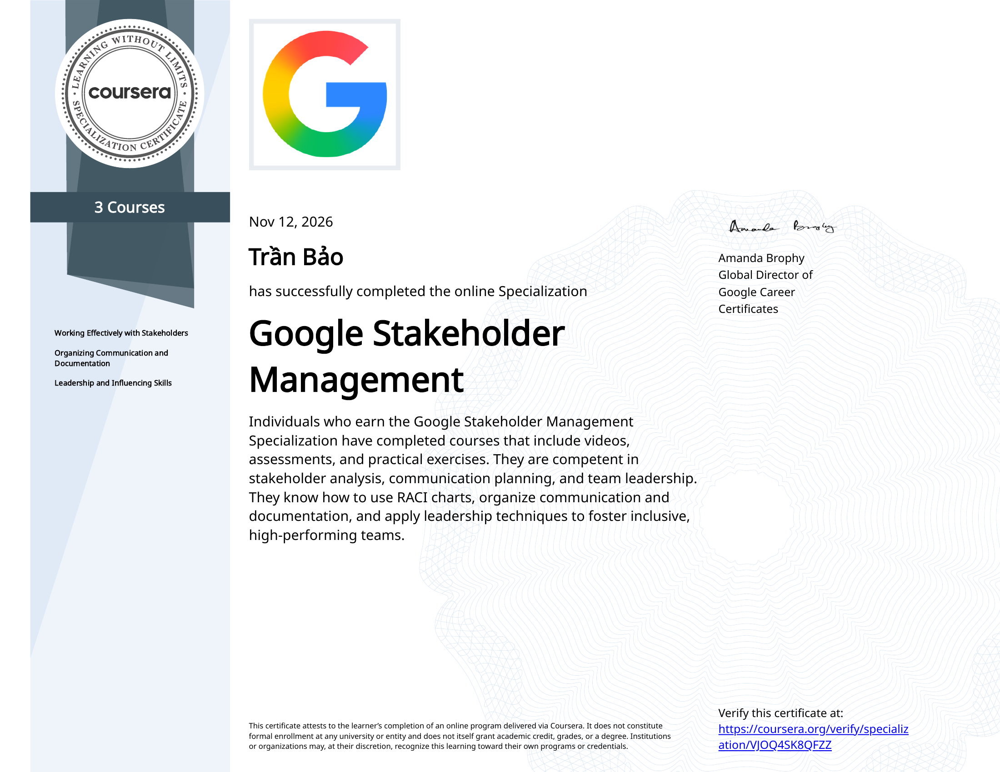
</p>

<details>
<summary>&nbsp;&nbsp;&nbsp;&nbsp;📚 <strong>Xem 3 chứng chỉ thành phần</strong></summary>
<br/>

<table width="100%">
  <tr>
    <td align="center" width="50%" valign="top">
      <strong>Working Effectively with Stakeholders</strong><br/>
      <sub><a href="https://coursera.org/verify/KGYZFUR0778U">Xác thực chứng chỉ</a></sub><br/><br/>
      
    </td>
    <td align="center" width="50%" valign="top">
      <strong>Organizing Communication and Documentation</strong><br/>
      <sub><a href="https://coursera.org/verify/OLB5OI3A5W8L">Xác thực chứng chỉ</a></sub><br/><br/>
      
    </td>
  </tr>
  <tr>
    <td align="center" width="50%" valign="top">
      <strong>Leadership and Influencing Skills</strong><br/>
      <sub><a href="https://coursera.org/verify/S4SUQITP49MH">Xác thực chứng chỉ</a></sub><br/><br/>
      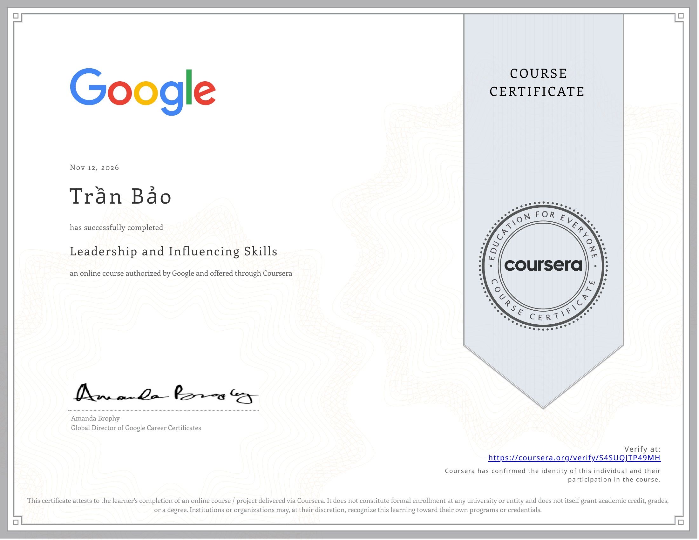
    </td>
    <td align="center" width="50%" valign="top"></td>
  </tr>
</table>

</details>
</details>

<br/>

<details>
<summary>🎓 <strong>Google Digital Marketing &amp; E-commerce Professional Certificate</strong> &nbsp;(Đã hoàn thành)</summary>
<br/>

- **Tổ chức cấp:** Google qua Coursera
- **Ngày cấp:** 13/11/2026
- **Xác thực:** [Verify Professional Certificate](https://coursera.org/verify/professional-cert/ON4JLNE4NL81)
- **Tổng quan:** Chứng chỉ chuyên nghiệp 8 khóa học về tiếp thị số và thương mại điện tử: chiến lược marketing số, thu hút khách hàng, email marketing, đo lường hiệu suất và vận hành cửa hàng trực tuyến.

<p align="center">
  
</p>

<details>
<summary>&nbsp;&nbsp;&nbsp;&nbsp;📚 <strong>Xem 8 chứng chỉ thành phần</strong></summary>
<br/>

<table width="100%">
  <tr>
    <td align="center" width="50%" valign="top">
      <strong>Foundations of Digital Marketing and E-commerce</strong><br/>
      <sub><a href="https://coursera.org/verify/GA3FAX5PS766">Xác thực chứng chỉ</a></sub><br/><br/>
      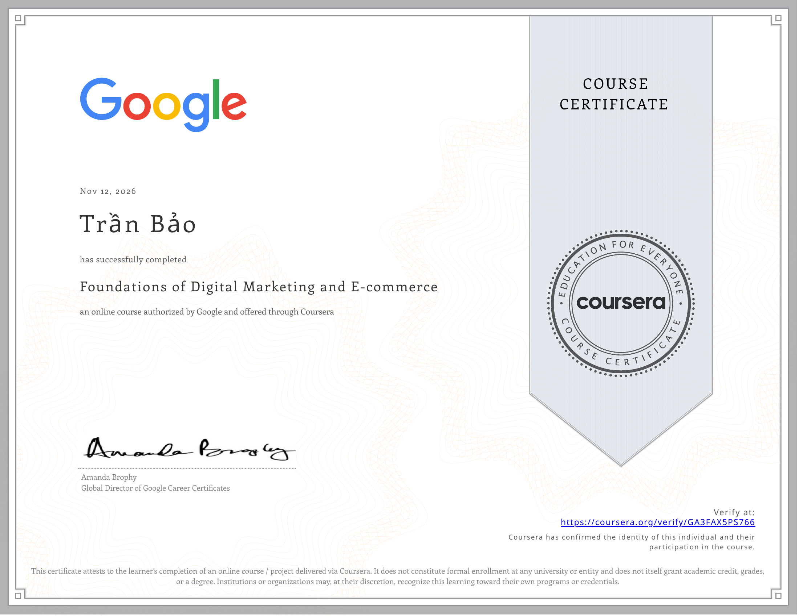
    </td>
    <td align="center" width="50%" valign="top">
      <strong>Attract and Engage Customers with Digital Marketing</strong><br/>
      <sub><a href="https://coursera.org/verify/4VTS7IZ4DOT3">Xác thực chứng chỉ</a></sub><br/><br/>
      
    </td>
  </tr>
  <tr>
    <td align="center" width="50%" valign="top">
      <strong>From Likes to Leads: Interact with Customers Online</strong><br/>
      <sub><a href="https://coursera.org/verify/08NANXFK393K">Xác thực chứng chỉ</a></sub><br/><br/>
      
    </td>
    <td align="center" width="50%" valign="top">
      <strong>Think Outside the Inbox: Email Marketing</strong><br/>
      <sub><a href="https://coursera.org/verify/N9FNHEF30VSP">Xác thực chứng chỉ</a></sub><br/><br/>
      
    </td>
  </tr>
  <tr>
    <td align="center" width="50%" valign="top">
      <strong>Assess for Success: Marketing Analytics and Measurement</strong><br/>
      <sub><a href="https://coursera.org/verify/B1ULZ0UKB0RV">Xác thực chứng chỉ</a></sub><br/><br/>
      
    </td>
    <td align="center" width="50%" valign="top">
      <strong>Make the Sale: Build, Launch, and Manage E-commerce Stores</strong><br/>
      <sub><a href="https://coursera.org/verify/RSFWM3XJHZ9Z">Xác thực chứng chỉ</a></sub><br/><br/>
      
    </td>
  </tr>
  <tr>
    <td align="center" width="50%" valign="top">
      <strong>Satisfaction Guaranteed: Develop Customer Loyalty Online</strong><br/>
      <sub><a href="https://coursera.org/verify/R7MZYGL6HZTT">Xác thực chứng chỉ</a></sub><br/><br/>
      
    </td>
    <td align="center" width="50%" valign="top">
      <strong>Accelerate Your Job Search with AI</strong><br/>
      <sub><a href="https://coursera.org/verify/GYOETDKLOOFO">Xác thực chứng chỉ</a></sub><br/><br/>
      
    </td>
  </tr>
</table>

</details>
</details>

<br/>

<details>
<summary>🎓 <strong>Các chứng chỉ khóa học chuyên đề Google bổ sung</strong> &nbsp;(Đã hoàn thành)</summary>
<br/>

- **Tổ chức cấp:** Google qua Coursera
- **Ngày cấp:** 12–13/11/2026
- **Tổng quan:** 12 chứng chỉ khóa học chuyên đề bổ sung từ Google qua Coursera thuộc các mảng hạ tầng mạng &amp; bảo mật hệ thống, tiếp thị truyền thông &amp; thương mại điện tử và lãnh đạo đội nhóm.

<details>
<summary>&nbsp;&nbsp;&nbsp;&nbsp;📚 <strong>Xem 12 chứng chỉ thành phần</strong></summary>
<br/>

<table width="100%">
  <tr>
    <td align="center" width="50%" valign="top">
      <strong>Network Architecture</strong><br/>
      <sub><a href="https://coursera.org/verify/BO9VN4Z89YZT">Xác thực chứng chỉ</a></sub><br/><br/>
      
    </td>
    <td align="center" width="50%" valign="top">
      <strong>Network Operations</strong><br/>
      <sub><a href="https://coursera.org/verify/5UUFTWV9T3LN">Xác thực chứng chỉ</a></sub><br/><br/>
      
    </td>
  </tr>
  <tr>
    <td align="center" width="50%" valign="top">
      <strong>Introduction to Detection and Incident Response</strong><br/>
      <sub><a href="https://coursera.org/verify/BO62CEZR8IFO">Xác thực chứng chỉ</a></sub><br/><br/>
      
    </td>
    <td align="center" width="50%" valign="top">
      <strong>Secure Against Network Intrusions</strong><br/>
      <sub><a href="https://coursera.org/verify/H1O2YCAAIIPK">Xác thực chứng chỉ</a></sub><br/><br/>
      
    </td>
  </tr>
  <tr>
    <td align="center" width="50%" valign="top">
      <strong>Security Hardening</strong><br/>
      <sub><a href="https://coursera.org/verify/HQMJGXCGRK6C">Xác thực chứng chỉ</a></sub><br/><br/>
      
    </td>
    <td align="center" width="50%" valign="top">
      <strong>Capture and Captivate Your Audience</strong><br/>
      <sub><a href="https://coursera.org/verify/MSFZAV1XCWP1">Xác thực chứng chỉ</a></sub><br/><br/>
      
    </td>
  </tr>
  <tr>
    <td align="center" width="50%" valign="top">
      <strong>Listening and Engagement on Social Media</strong><br/>
      <sub><a href="https://coursera.org/verify/POC41WBJB50E">Xác thực chứng chỉ</a></sub><br/><br/>
      
    </td>
    <td align="center" width="50%" valign="top">
      <strong>Transform Engagement into Customers</strong><br/>
      <sub><a href="https://coursera.org/verify/5TCGLGM2MWSO">Xác thực chứng chỉ</a></sub><br/><br/>
      
    </td>
  </tr>
  <tr>
    <td align="center" width="50%" valign="top">
      <strong>Engage Customers With an Online Store</strong><br/>
      <sub><a href="https://coursera.org/verify/O5SB42AX36DE">Xác thực chứng chỉ</a></sub><br/><br/>
      
    </td>
    <td align="center" width="50%" valign="top">
      <strong>Create a High-Performing Team</strong><br/>
      <sub><a href="https://coursera.org/verify/ITAJ1UTVWLVQ">Xác thực chứng chỉ</a></sub><br/><br/>
      
    </td>
  </tr>
  <tr>
    <td align="center" width="50%" valign="top">
      <strong>Set and Achieve Team Goals</strong><br/>
      <sub><a href="https://coursera.org/verify/XD1R5HT6ZT1N">Xác thực chứng chỉ</a></sub><br/><br/>
      
    </td>
    <td align="center" width="50%" valign="top">
      <strong>Support Individual Growth and Development</strong><br/>
      <sub><a href="https://coursera.org/verify/KS58B2X0RCR1">Xác thực chứng chỉ</a></sub><br/><br/>
      
    </td>
  </tr>
</table>

</details>
</details>

<br/>

<details>
<summary>🎓 <strong>AI Application for Game, Web, and Project Management</strong></summary>
<br/>

- **Đơn vị tổ chức:** Công ty TNHH Lượng Từ Xanh (Green Quantum Company)
- **Thời gian:** 04 – 15/02/2026
- **Địa điểm:** TP. Hồ Chí Minh, Việt Nam
- **Tổng quan:** Khóa học thực chiến tích hợp công nghệ AI vào kiến trúc phần mềm thực tế, hệ thống game và quản lý dự án linh hoạt (Agile).

<p align="center">
  
</p>
</details>

<br/>

<details>
<summary>🎓 <strong>Financial Data Analysis and Decision-Making in the Advent of AI</strong></summary>
<br/>

- **Trạng thái:** Đã hoàn thành
- **Tổng quan:** Nền tảng phân tích dữ liệu tài chính tính toán, các chỉ số thống kê và mô hình hóa quyết định được hỗ trợ bởi các công cụ AI.

<p align="center">
  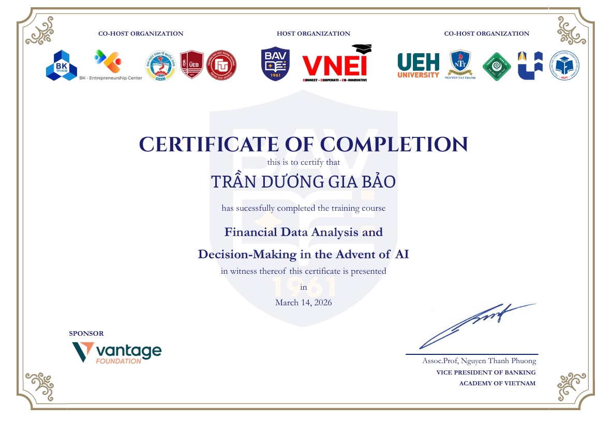
</p>
</details>

<br/>

<details>
<summary>🎓 <strong>Gemini Certified (Google)</strong></summary>
<br/>

- **Trạng thái:** Đã chứng nhận
- **Tổng quan:** Chứng minh năng lực thành thạo các tính năng đa phương thức của Google Gemini trong học thuật, tổng hợp nội dung, phương pháp nghiên cứu và quy trình học tập.

<table width="100%">
  <tr>
    <td align="center" width="50%" valign="top">
      <strong>Gemini Certified Educator</strong><br/><br/>
      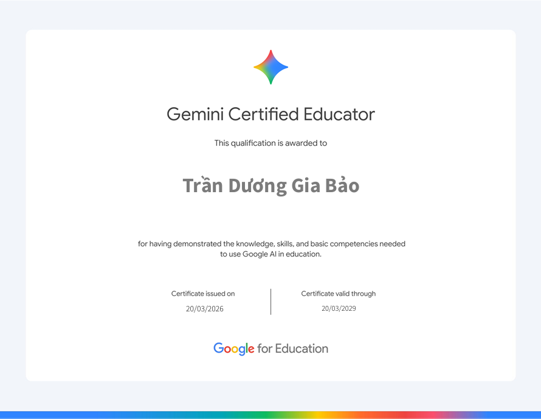
    </td>
    <td align="center" width="50%" valign="top">
      <strong>Gemini Certified University Student</strong><br/><br/>
      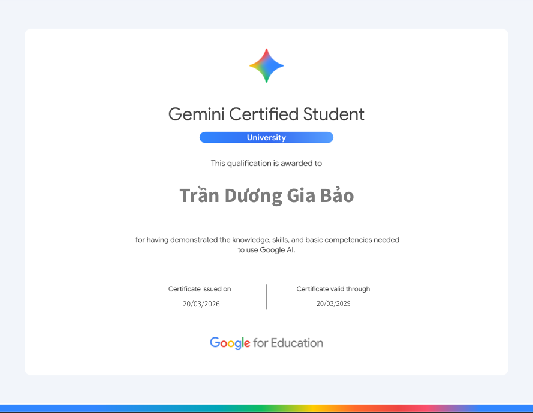
    </td>
  </tr>
</table>
</details>

---

### 📊 Thống kê GitHub

<div align="center">


&nbsp;


<br/><br/>


</div>

---

### 📬 Liên hệ với tôi

<div align="center">

<a href="mailto:tranduonggiabao0501email@gmail.com">
  
</a>
&nbsp;
<a href="https://peo051.github.io/portfolio/">
  
</a>
&nbsp;
<a href="https://www.linkedin.com/in/peo0501">
  
</a>
&nbsp;
<a href="https://github.com/Peo051">
  
</a>

</div>

<br/>

---

<div align="center">


<sub><i>"First, solve the problem. Then, write the code." — John Johnson</i></sub>

</div>
