<a id="top"></a>

<p align="center">
  
</p>

<h1 align="center">陈阳嘉宝 (Tran Duong Gia Bao) | Peo051</h1>
<p align="center"><strong>软件工程专业学生 | 后端架构设计 | 应用人工智能</strong></p>

<p align="center">
  
</p>

<p align="center">
  <a href="mailto:tranduonggiabao0501email@gmail.com"></a>
  <a href="https://peo051.github.io/portfolio/"></a>
  <a href="https://www.linkedin.com/in/peo0501"></a>
  
</p>

<table align="center">
  <tr>
    <td align="center"><strong>角色</strong><br/>软件工程</td>
    <td align="center"><strong>核心方向</strong><br/>后端与应用AI</td>
    <td align="center"><strong>架构体系</strong><br/>前端 · 后端 · 系统</td>
    <td align="center"><strong>学历背景</strong><br/>HUIT 计算机系在读</td>
  </tr>
</table>

<br/>

<p align="center">
  <a href="https://github.com/Peo051"></a>
  &nbsp;
  <a href="https://github.com/Peo051/Peo051/blob/main/README.vi.md"></a>
  &nbsp;
  <a href="https://github.com/Peo051/Peo051/blob/main/README.zh.md"></a>
</p>

---

### 👤 关于我

```yaml
# 陈阳嘉宝 (Tran Duong Gia Bao) — 软件工程专业学生

所在地      : 越南 胡志明市 (Ho Chi Minh City, Vietnam)
大学        : 胡志明市工业与贸易大学 (HUIT)
专业        : 信息技术 (Information Technology)
邮箱        : tranduonggiabao0501email@gmail.com
个人主页    : https://peo051.github.io/portfolio/

核心方向:
  - 基于 C# / .NET 8 和 ASP.NET Core 的后端与全栈系统开发
  - RESTful API 架构、关系型数据库设计与 WPF / MVVM 桌面应用程序
  - 基于 Python、YOLOv8 与 OpenCV 的应用人工智能与计算机视觉 (AI & CV)
  - 高效用项集挖掘 (High-Utility Itemset Mining) 数据挖掘算法研究

目前状态:
  - 积极打造涵盖桌面端、Web端与AI的生产级实战项目
  - 坚持将扎实的软件工程基础与前沿算法研究深度融合
```

---

### 🛠️ 专业技能

<div align="left">

#### 💻 编程语言
<p>
  
  
  
  
  
  
  
  
  
  
</p>

#### ⚙️ 后端与系统架构
<p>
  
  
  
  
  
  
</p>

#### 🧠 人工智能与前沿研究
<p>
  
  
  
  
  
  
</p>

#### 🗄️ 数据库与云原生服务
<p>
  
  
  
  
  
</p>

#### 🛠️ 开发与协作工具
<p>
  
  
  
  
  
  
</p>

</div>

---

### 📌 重点项目

<table>
  <tr>
    <td width="50%" valign="top">
      <h3>🤖 <a href="https://github.com/Peo051/love-sense-ai">CodeSense AI (自适应编程导师)</a></h3>
      <p>
        <a href="https://github.com/Peo051/love-sense-ai"></a>
        <a href="https://love-sense-ai.vercel.app"></a>
      </p>
      <p><strong>技术栈:</strong> <code>Next.js</code> • <code>FastAPI</code> • <code>TypeScript</code> • <code>PostgreSQL</code> • <code>Firebase Auth</code> • <code>Tailwind CSS</code></p>
      <p>面向 C# OOP 初学者的全栈自适应编程辅助教学平台。集成 Next.js 前端与 FastAPI 后端，支持持久化会话数据、Firebase 鉴权、OCR 代码识别与苏格拉底式渐进引导算法。</p>
    </td>
    <td width="50%" valign="top">
      <h3>🌿 <a href="https://github.com/Peo051/Tri-Nghia-Pharma">Tri Nghia Pharma (医药电商小程序)</a></h3>
      <p>
        <a href="https://github.com/Peo051/Tri-Nghia-Pharma"></a>
        <a href="https://github.com/Peo051/Tri-Nghia-Pharma"></a>
      </p>
      <p><strong>技术栈:</strong> <code>React 18</code> • <code>TypeScript</code> • <code>Vite</code> • <code>Tailwind CSS</code> • <code>Zalo Mini App (ZMP)</code></p>
      <p>运行于 Zalo 平台的医药电商与健康服务小程序，服务于 Trí Nghĩa Pharma 与 Opodis Pharma。支持药品分类导航、处方详情查看、实时购物车与 VietQR 支付。</p>
    </td>
  </tr>
  <tr>
    <td width="50%" valign="top">
      <h3>☕ <a href="https://github.com/Peo051/Coffee_Shop_Management_WPF">Coffee Shop Management (WPF POS)</a></h3>
      <p>
        <a href="https://github.com/Peo051/Coffee_Shop_Management_WPF"></a>
      </p>
      <p><strong>技术栈:</strong> <code>C#</code> • <code>.NET 8</code> • <code>WPF (MVVM)</code> • <code>ASP.NET Core Web API</code> • <code>SQL Server</code> • <code>PayOS / VietQR</code></p>
      <p>企业级咖啡门店桌面端 POS 与综合运营系统：进销存、员工排班、客户积分及财务报表。采用 MVVM 架构配合解耦的 ASP.NET Core 支付 API 与 HMAC-SHA256 签名校验。</p>
    </td>
    <td width="50%" valign="top">
      <h3>☕ <a href="https://github.com/Peo051/Coffee_Shop_Management_Web">Coffee_Shop_Management_Web</a></h3>
      <p>
        <a href="https://github.com/Peo051/Coffee_Shop_Management_Web"></a>
        <a href="https://giborcoffee.vercel.app"></a>
      </p>
      <p><strong>技术栈:</strong> <code>HTML5</code> • <code>CSS3</code> • <code>JavaScript</code> • <code>Bootstrap 5.3</code> • <code>Firebase</code> • <code>Serverless PayOS</code></p>
      <p>在线咖啡点单与电商网站：支持商品浏览、购物车结算、会员账号体系、分店管理与 VietQR / 货到付款支付流程。</p>
    </td>
  </tr>
  <tr>
    <td width="50%" valign="top">
      <h3>🌐 <a href="https://peo051.github.io/portfolio/">个人在线作品集网站</a></h3>
      <p>
        <a href="https://peo051.github.io/portfolio/"></a>
      </p>
      <p><strong>技术栈:</strong> <code>HTML5</code> • <code>CSS3</code> • <code>JavaScript</code> • <code>GitHub Pages</code></p>
      <p>响应式个人门户主页，动态展示代表性项目、专业技能树、科研成果、权威证书与即时联络通道。</p>
    </td>
    <td width="50%" valign="top">
      <h3>🧮 <a href="https://github.com/Peo051/Calculator">经典风格桌面计算器</a></h3>
      <p><strong>技术栈:</strong> <code>C#</code> • <code>WPF</code> • <code>.NET 8</code> • <code>MVVM</code></p>
      <p>仿 Windows 风格桌面计算器，涵盖四则运算、历史记录留存、内存暂存按键、键盘快捷响应与清晰的 MVVM 架构分层。</p>
    </td>
  </tr>
  <tr>
    <td width="50%" valign="top">
      <h3>🚗 <a href="https://github.com/Peo051/QuanLiBaiDoXe">智能停车场管理系统模拟</a></h3>
      <p><strong>技术栈:</strong> <code>C++</code> • <code>数据结构与算法</code> • <code>文件 I/O</code></p>
      <p>基于 C++ 的停车场出入库调度与管理模拟系统，应用经典数据结构实现车流调控、车位智能分配算法与持久化日志管理。</p>
    </td>
    <td width="50%" valign="top">
    </td>
  </tr>
</table>

---

### 🏆 荣誉与竞赛

<details>
<summary><strong>Database Design Challenge — HUIT, 2025–2026 学年</strong> &nbsp;🏅 <em>鼓励奖 (Encouragement Prize)</em></summary>
<br/>
<p align="center">
  
</p>
<p align="center">
  <em>参加由胡志明市工业与贸易大学 (HUIT) 计算机科学系主办的专业数据库设计学术竞赛，并荣获鼓励奖。</em>
</p>
</details>

<br/>

<details>
<summary><strong>校级数据科学竞赛 — 决赛 (Final Round)</strong> &nbsp;🔬 <em>决赛赛道入围</em></summary>
<br/>
<table width="100%">
  <tr>
    <td align="center" width="50%">
      <strong>水稻病虫害分类与分割</strong><br/>
      <sub>YOLO + SAM-ViT</sub><br/><br/>
      
    </td>
    <td align="center" width="50%">
      <strong>皮肤癌分类识别</strong><br/>
      <sub>Vision Transformer (ViT)</sub><br/><br/>
      
    </td>
  </tr>
</table>
<p align="center">
  <em>入围校级数据科学竞赛决赛，分别在计算机视觉目标分割与医学图像深度学习分类两大专业赛道展现研究成果。</em>
</p>
</details>

<br/>

<details>
<summary><strong>大学生科学研究竞赛 — HUIT, 2025–2026 学年</strong> &nbsp;🏅 <em>鼓励奖</em></summary>
<br/>
<table width="100%">
  <tr>
    <td align="center" width="50%">
      <strong>科研竞赛鼓励奖奖状</strong><br/><br/>
      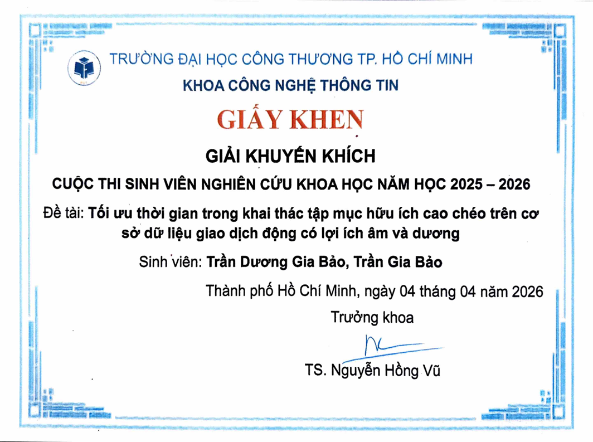
    </td>
    <td align="center" width="50%">
      <strong>科研项目立项与参会证书</strong><br/><br/>
      
    </td>
  </tr>
</table>

- **课题:** *“正负利润交易数据库中高效用项集挖掘的时间性能优化研究”*
- **团队成员:** 陈阳嘉宝 (Trần Dương Gia Bảo), 陈嘉宝 (Trần Gia Bảo)
- **指导教师:** 武文荣硕士 (ThS. Vũ Văn Vinh), 范晋顺硕士 (HV. Phạm Tấn Thuận)
- **答辩时间:** 2026年4月4日
- **项目源码:** [`HUIMiner`](https://github.com/Peo051/HUIMiner) &amp; [`CLHMiner`](https://github.com/Peo051/CLHMiner)

<p align="center">
  <em>在胡志明市工业与贸易大学计算机学院大学生科学研究会议上答辩科研课题，并荣获鼓励奖。</em>
</p>
</details>

---

### 📜 专业认证

<details>
<summary>🎓 <strong>Google AI Professional Certificate (Google AI 专业认证)</strong> &nbsp;(已完成)</summary>
<br/>

- **颁发机构:** Google via Coursera
- **签发日期:** 2026年4月20日
- **凭证核验:** [Verify Professional Certificate](https://coursera.org/verify/professional-cert/9477RZVHLC2N)
- **概览:** 涵盖 AI 基础原理、Prompt 提示词设计体系、文献洞察、内容创作、数据智能分析及 AI 系统架构开发的 7 门进阶课程认证。

<p align="center">
  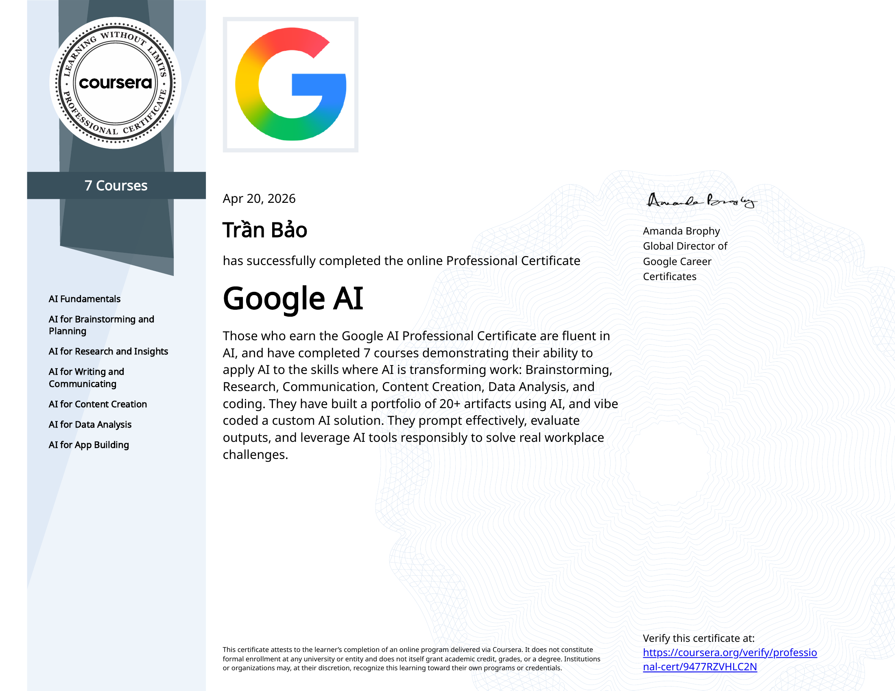
</p>

<details>
<summary>&nbsp;&nbsp;&nbsp;&nbsp;📚 <strong>查看 7 门课程结业证书</strong></summary>
<br/>

<table width="100%">
  <tr>
    <td align="center" width="50%" valign="top">
      <strong>AI Fundamentals</strong><br/>
      <sub><a href="https://coursera.org/verify/LBBNAPKH73YU">核验凭证</a></sub><br/><br/>
      
    </td>
    <td align="center" width="50%" valign="top">
      <strong>AI for Brainstorming and Planning</strong><br/>
      <sub><a href="https://coursera.org/verify/CXD4JWUUX6R1">核验凭证</a></sub><br/><br/>
      
    </td>
  </tr>
  <tr>
    <td align="center" width="50%" valign="top">
      <strong>AI for Research and Insights</strong><br/>
      <sub><a href="https://coursera.org/verify/82WE4Y9VAF24">核验凭证</a></sub><br/><br/>
      
    </td>
    <td align="center" width="50%" valign="top">
      <strong>AI for Writing and Communicating</strong><br/>
      <sub><a href="https://coursera.org/verify/Q1LLZP8ZJDZO">核验凭证</a></sub><br/><br/>
      
    </td>
  </tr>
  <tr>
    <td align="center" width="50%" valign="top">
      <strong>AI for Content Creation</strong><br/>
      <sub><a href="https://coursera.org/verify/96M51QHX14HM">核验凭证</a></sub><br/><br/>
      
    </td>
    <td align="center" width="50%" valign="top">
      <strong>AI for Data Analysis</strong><br/>
      <sub><a href="https://coursera.org/verify/0LYML214PN23">核验凭证</a></sub><br/><br/>
      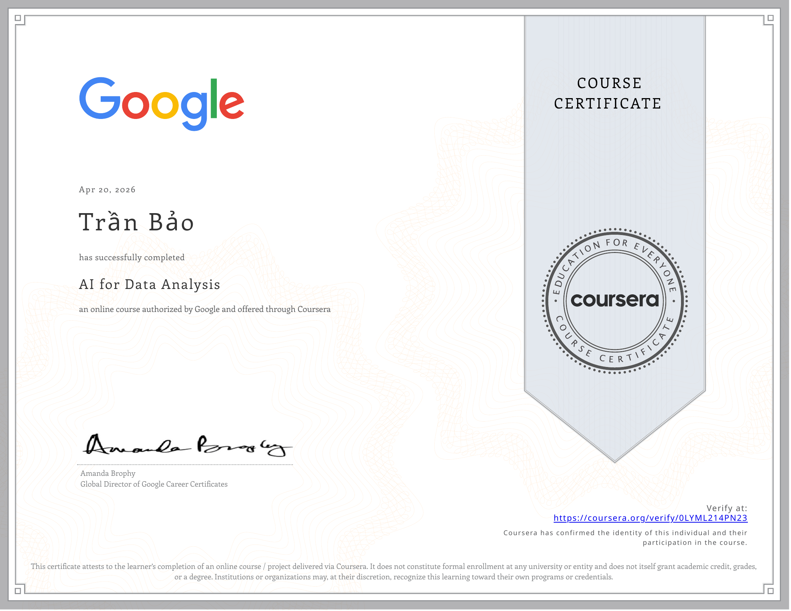
    </td>
  </tr>
  <tr>
    <td align="center" width="50%" valign="top">
      <strong>AI for App Building</strong><br/>
      <sub><a href="https://coursera.org/verify/5TKOALL9R78O">核验凭证</a></sub><br/><br/>
      
    </td>
    <td align="center" width="50%" valign="top"></td>
  </tr>
</table>

</details>
</details>

<br/>

<details>
<summary>🎓 <strong>Google AI Essentials Specialization (Google AI 基础专项认证)</strong> &nbsp;(已完成)</summary>
<br/>

- **颁发机构:** Google via Coursera
- **签发日期:** 2026年4月24日
- **凭证核验:** [Verify Specialization](https://coursera.org/verify/specialization/OA4F9JXTDQV2)
- **概览:** 建立生成式 AI 实用基础能力、工作流效率提升、Prompt 工程以及负责任的 AI 实践专项认证。

<p align="center">
  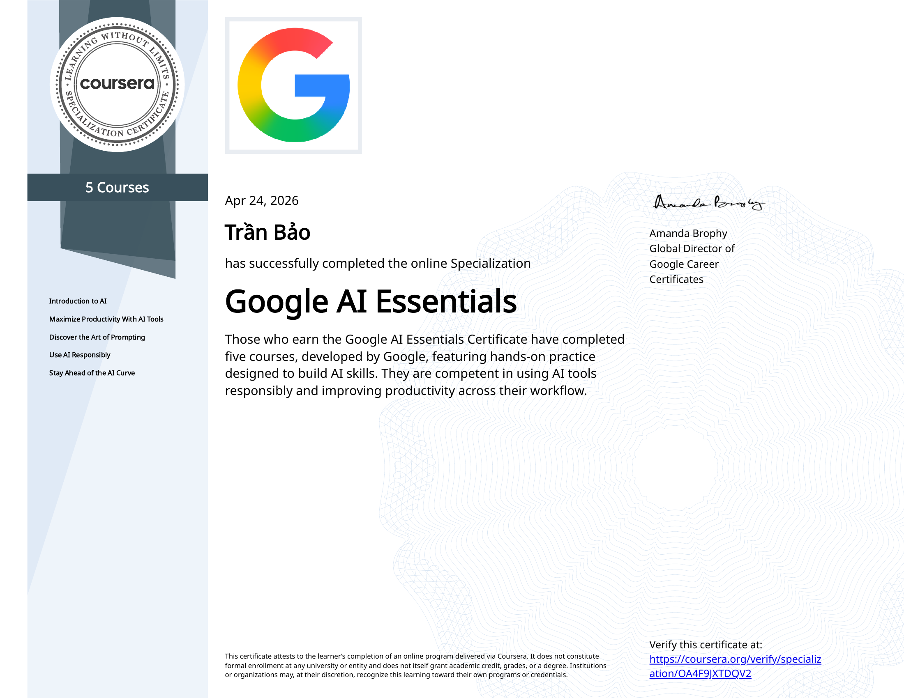
</p>

<details>
<summary>&nbsp;&nbsp;&nbsp;&nbsp;📚 <strong>查看 5 门课程结业证书</strong></summary>
<br/>

<table width="100%">
  <tr>
    <td align="center" width="50%" valign="top">
      <strong>Introduction to AI</strong><br/>
      <sub><a href="https://coursera.org/verify/GGGCSVFYV6Z7">核验凭证</a></sub><br/><br/>
      
    </td>
    <td align="center" width="50%" valign="top">
      <strong>Maximize Productivity With AI Tools</strong><br/>
      <sub><a href="https://coursera.org/verify/YLBW8IUHL2AT">核验凭证</a></sub><br/><br/>
      
    </td>
  </tr>
  <tr>
    <td align="center" width="50%" valign="top">
      <strong>Discover the Art of Prompting</strong><br/>
      <sub><a href="https://coursera.org/verify/95K4US2N6RI4">核验凭证</a></sub><br/><br/>
      
    </td>
    <td align="center" width="50%" valign="top">
      <strong>Use AI Responsibly</strong><br/>
      <sub><a href="https://coursera.org/verify/67U9FYD7X0F3">核验凭证</a></sub><br/><br/>
      
    </td>
  </tr>
  <tr>
    <td align="center" width="50%" valign="top">
      <strong>Stay Ahead of the AI Curve</strong><br/>
      <sub><a href="https://coursera.org/verify/LAOTVMIOVCJW">核验凭证</a></sub><br/><br/>
      
    </td>
    <td align="center" width="50%" valign="top"></td>
  </tr>
</table>

</details>
</details>

<br/>

<details>
<summary>🎓 <strong>Accelerate Your Job Search with AI Specialization (AI 求职加速专项认证)</strong> &nbsp;(已完成)</summary>
<br/>

- **颁发机构:** Google via Coursera
- **签发日期:** 2026年4月25日
- **凭证核验:** [Verify Specialization](https://coursera.org/verify/specialization/DM1GGN4MS6QF)
- **概览:** 利用 AI 优化现代求职流程的专项认证，包括技能盘点、职业战略调研、申请优化及模拟面试。

<p align="center">
  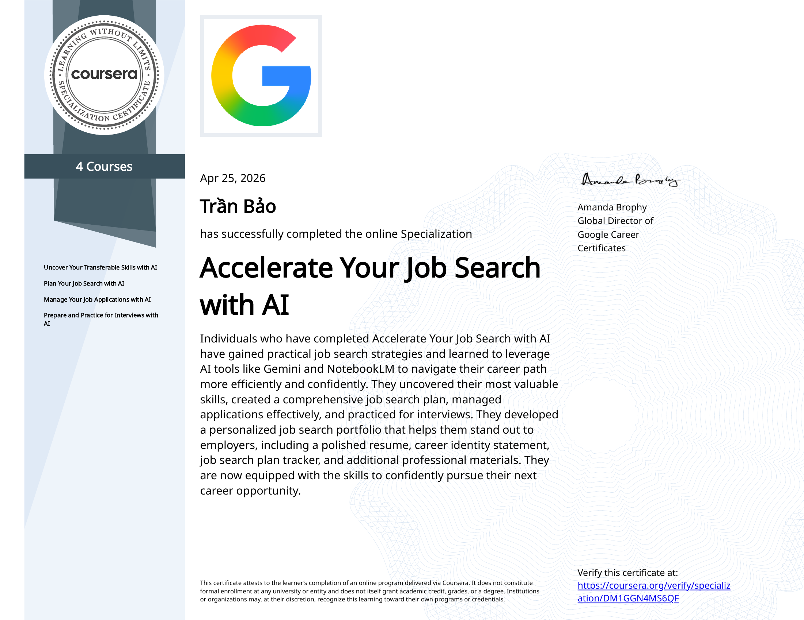
</p>

<details>
<summary>&nbsp;&nbsp;&nbsp;&nbsp;📚 <strong>查看 4 门课程结业证书</strong></summary>
<br/>

<table width="100%">
  <tr>
    <td align="center" width="50%" valign="top">
      <strong>Uncover Your Transferable Skills with AI</strong><br/>
      <sub><a href="https://coursera.org/verify/BOXPIJ1FTNTO">核验凭证</a></sub><br/><br/>
      
    </td>
    <td align="center" width="50%" valign="top">
      <strong>Plan Your Job Search with AI</strong><br/>
      <sub><a href="https://coursera.org/verify/4KVCJ4AEDZSB">核验凭证</a></sub><br/><br/>
      
    </td>
  </tr>
  <tr>
    <td align="center" width="50%" valign="top">
      <strong>Manage Your Job Applications with AI</strong><br/>
      <sub><a href="https://coursera.org/verify/4EEKR5ME6QIY">核验凭证</a></sub><br/><br/>
      
    </td>
    <td align="center" width="50%" valign="top">
      <strong>Prepare and Practice for Interviews with AI</strong><br/>
      <sub><a href="https://coursera.org/verify/RBQ3URO1UDZ5">核验凭证</a></sub><br/><br/>
      
    </td>
  </tr>
</table>

</details>
</details>

<br/>

<details>
<summary>🎓 <strong>Google Prompting Essentials Specialization (Google 提示词核心专项认证)</strong> &nbsp;(已完成)</summary>
<br/>

- **颁发机构:** Google via Coursera
- **签发日期:** 2026年4月25日
- **凭证核验:** [Verify Specialization](https://coursera.org/verify/specialization/L8HEWMHNUMWE)
- **概览:** 面向复杂日常任务的高级提示词设计方法论、快速数据分析、演示文稿自动化以及将 AI 模型作为协作伙伴的专项认证。

<p align="center">
  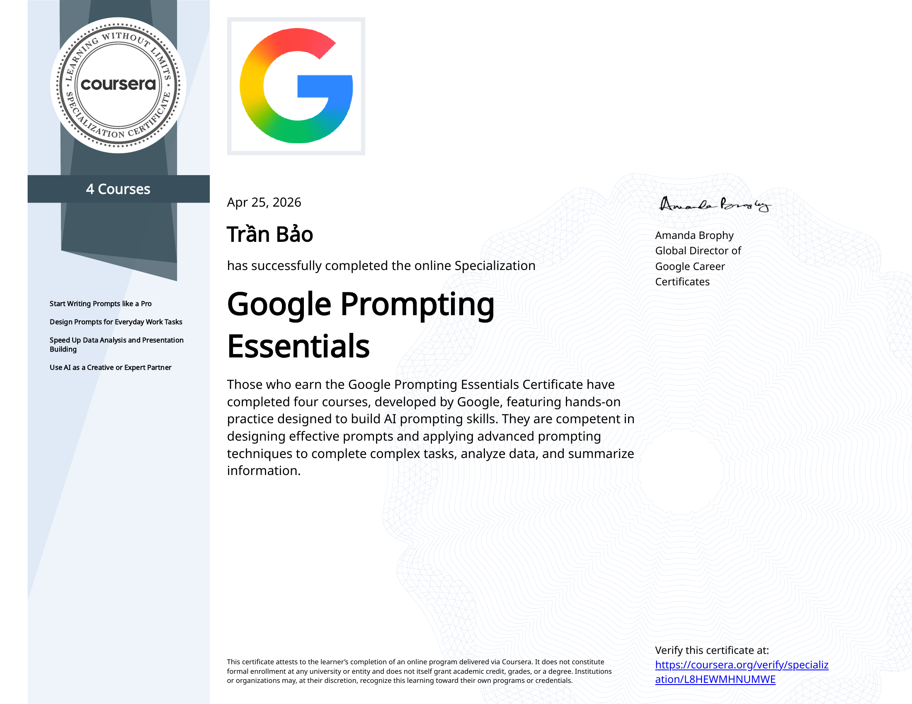
</p>

<details>
<summary>&nbsp;&nbsp;&nbsp;&nbsp;📚 <strong>查看 4 门课程结业证书</strong></summary>
<br/>

<table width="100%">
  <tr>
    <td align="center" width="50%" valign="top">
      <strong>Start Writing Prompts like a Pro</strong><br/>
      <sub><a href="https://coursera.org/verify/7D7NHC7BYM89">核验凭证</a></sub><br/><br/>
      
    </td>
    <td align="center" width="50%" valign="top">
      <strong>Design Prompts for Everyday Work Tasks</strong><br/>
      <sub><a href="https://coursera.org/verify/Z8XRRMSZD9A9">核验凭证</a></sub><br/><br/>
      
    </td>
  </tr>
  <tr>
    <td align="center" width="50%" valign="top">
      <strong>Speed Up Data Analysis and Presentation Building</strong><br/>
      <sub><a href="https://coursera.org/verify/KEJ60APLHVJC">核验凭证</a></sub><br/><br/>
      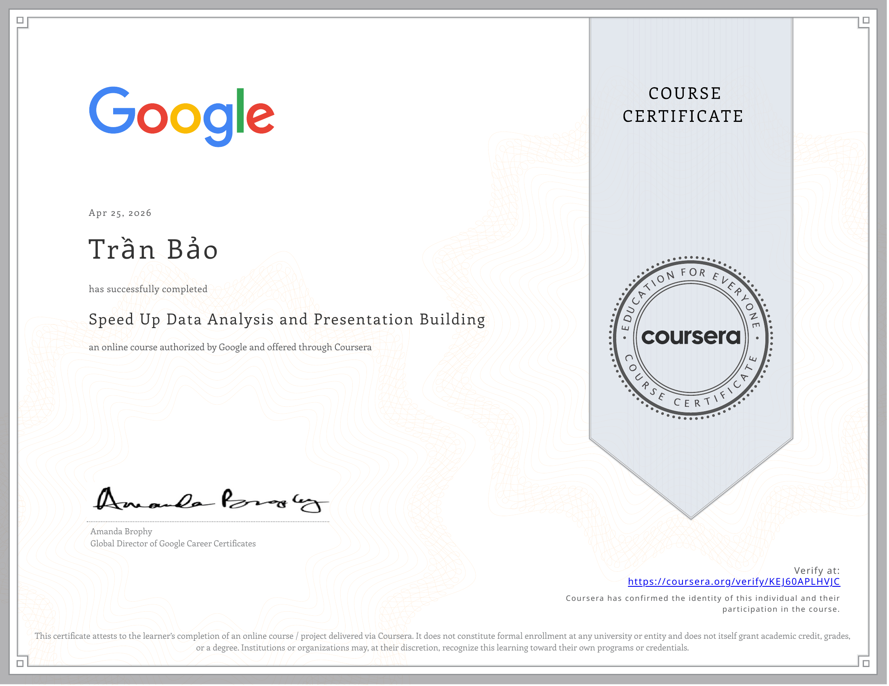
    </td>
    <td align="center" width="50%" valign="top">
      <strong>Use AI as a Creative or Expert Partner</strong><br/>
      <sub><a href="https://coursera.org/verify/XU8U2ROLZJ09">核验凭证</a></sub><br/><br/>
      
    </td>
  </tr>
</table>

</details>
</details>

<br/>

<details>
<summary>🎓 <strong>Google UX Design Professional Certificate (Google UX 设计专业认证)</strong> &nbsp;(已完成)</summary>
<br/>

- **颁发机构:** Google via Coursera
- **签发日期:** 2026年4月25日
- **凭证核验:** [Verify Professional Certificate](https://coursera.org/verify/professional-cert/CO07OPHIC3ER)
- **概览:** 涵盖用户共情、线框图绘制、Figma 高保真原型设计、UX 调研、动态网页界面及 AI 辅助职业准备的 8 门全面 UX 设计课程认证。

<p align="center">
  
</p>

<details>
<summary>&nbsp;&nbsp;&nbsp;&nbsp;📚 <strong>查看 8 门课程结业证书</strong></summary>
<br/>

<table width="100%">
  <tr>
    <td align="center" width="50%" valign="top">
      <strong>Foundations of User Experience (UX) Design</strong><br/>
      <sub><a href="https://coursera.org/verify/5ACPWD0XBD3W">核验凭证</a></sub><br/><br/>
      
    </td>
    <td align="center" width="50%" valign="top">
      <strong>Start the UX Design Process: Empathize, Define, and Ideate</strong><br/>
      <sub><a href="https://coursera.org/verify/926MG2ZZPQEE">核验凭证</a></sub><br/><br/>
      
    </td>
  </tr>
  <tr>
    <td align="center" width="50%" valign="top">
      <strong>Build Wireframes and Low-Fidelity Prototypes</strong><br/>
      <sub><a href="https://coursera.org/verify/NXO21IME4XM4">核验凭证</a></sub><br/><br/>
      
    </td>
    <td align="center" width="50%" valign="top">
      <strong>Conduct UX Research and Test Early Concepts</strong><br/>
      <sub><a href="https://coursera.org/verify/Y4K2LKTMUPSV">核验凭证</a></sub><br/><br/>
      
    </td>
  </tr>
  <tr>
    <td align="center" width="50%" valign="top">
      <strong>Create High-Fidelity Designs &amp; Prototypes in Figma</strong><br/>
      <sub><a href="https://coursera.org/verify/33K9GDA8MMPT">核验凭证</a></sub><br/><br/>
      
    </td>
    <td align="center" width="50%" valign="top">
      <strong>Build Dynamic User Interfaces (UI) for Websites</strong><br/>
      <sub><a href="https://coursera.org/verify/DRQSN9BG2QL2">核验凭证</a></sub><br/><br/>
      
    </td>
  </tr>
  <tr>
    <td align="center" width="50%" valign="top">
      <strong>Design a User Experience for Social Good &amp; Prepare for Jobs</strong><br/>
      <sub><a href="https://coursera.org/verify/B7WZ416MKODO">核验凭证</a></sub><br/><br/>
      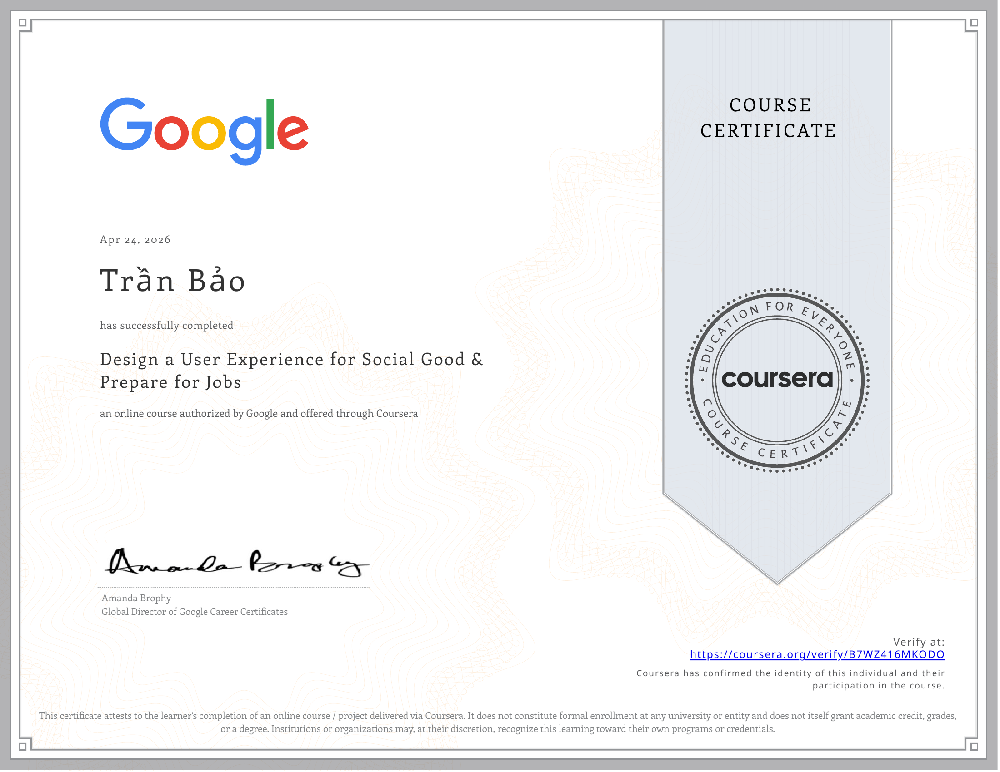
    </td>
    <td align="center" width="50%" valign="top">
      <strong>Accelerate Your Job Search with AI</strong><br/>
      <sub><a href="https://coursera.org/verify/GYOETDKLOOFO">核验凭证</a></sub><br/><br/>
      
    </td>
  </tr>
</table>

</details>
</details>

<br/>

<details>
<summary>🎓 <strong>Google Data Analytics Professional Certificate (Google 数据分析专业认证)</strong> &nbsp;(已完成)</summary>
<br/>

- **颁发机构:** Google via Coursera
- **签发日期:** 2026年11月13日
- **凭证核验:** [Verify Professional Certificate](https://coursera.org/verify/professional-cert/FM7X7JSY9X7N)
- **概览:** 涵盖数据准备与清洗、SQL、电子表格、Tableau 可视化、Python 数据分析及实战案例研究的 9 门数据分析专业认证。

<p align="center">
  
</p>

<details>
<summary>&nbsp;&nbsp;&nbsp;&nbsp;📚 <strong>查看 9 门课程结业证书</strong></summary>
<br/>

<table width="100%">
  <tr>
    <td align="center" width="50%" valign="top">
      <strong>Foundations: Data, Data, Everywhere</strong><br/>
      <sub><a href="https://coursera.org/verify/V7XHPOUYIO46">核验凭证</a></sub><br/><br/>
      
    </td>
    <td align="center" width="50%" valign="top">
      <strong>Ask Questions to Make Data-Driven Decisions</strong><br/>
      <sub><a href="https://coursera.org/verify/YWPTPGT3I2L0">核验凭证</a></sub><br/><br/>
      
    </td>
  </tr>
  <tr>
    <td align="center" width="50%" valign="top">
      <strong>Prepare Data for Exploration</strong><br/>
      <sub><a href="https://coursera.org/verify/PEQM4MAT85Y1">核验凭证</a></sub><br/><br/>
      
    </td>
    <td align="center" width="50%" valign="top">
      <strong>Process Data from Dirty to Clean</strong><br/>
      <sub><a href="https://coursera.org/verify/QBXBK8DO3WO1">核验凭证</a></sub><br/><br/>
      
    </td>
  </tr>
  <tr>
    <td align="center" width="50%" valign="top">
      <strong>Analyze Data to Answer Questions</strong><br/>
      <sub><a href="https://coursera.org/verify/Q7X9IRA3J2HY">核验凭证</a></sub><br/><br/>
      
    </td>
    <td align="center" width="50%" valign="top">
      <strong>Share Data Through the Art of Visualization</strong><br/>
      <sub><a href="https://coursera.org/verify/UYUVYEWFAMDZ">核验凭证</a></sub><br/><br/>
      
    </td>
  </tr>
  <tr>
    <td align="center" width="50%" valign="top">
      <strong>Introduction to Data Analysis Using Python</strong><br/>
      <sub><a href="https://coursera.org/verify/W0TAIBSCTJON">核验凭证</a></sub><br/><br/>
      
    </td>
    <td align="center" width="50%" valign="top">
      <strong>Google Data Analytics Capstone: Complete a Case Study</strong><br/>
      <sub><a href="https://coursera.org/verify/355OMIUHWCY">核验凭证</a></sub><br/><br/>
      
    </td>
  </tr>
  <tr>
    <td align="center" width="50%" valign="top">
      <strong>Accelerate Your Job Search with AI</strong><br/>
      <sub><a href="https://coursera.org/verify/GYOETDKLOOFO">核验凭证</a></sub><br/><br/>
      
    </td>
    <td align="center" width="50%" valign="top"></td>
  </tr>
</table>

</details>
</details>

<br/>

<details>
<summary>🎓 <strong>Google Advanced Data Analytics Professional Certificate (Google 高级数据分析专业认证)</strong> &nbsp;(已完成)</summary>
<br/>

- **颁发机构:** Google via Coursera
- **签发日期:** 2026年11月13日
- **凭证核验:** [Verify Professional Certificate](https://coursera.org/verify/professional-cert/833UEV1EEXWI)
- **概览:** 面向数据科学与高级分析岗位的 7 门进阶认证，涵盖统计分析、回归建模、机器学习与预测分析。

<p align="center">
  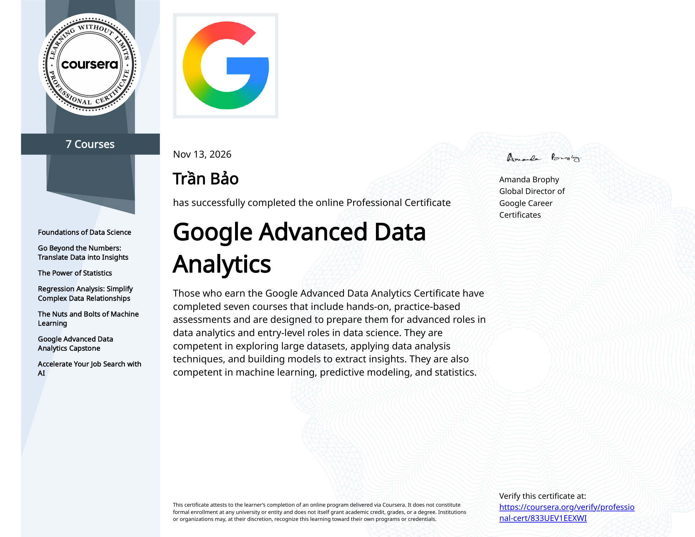
</p>

<details>
<summary>&nbsp;&nbsp;&nbsp;&nbsp;📚 <strong>查看 7 门课程结业证书</strong></summary>
<br/>

<table width="100%">
  <tr>
    <td align="center" width="50%" valign="top">
      <strong>Foundations of Data Science</strong><br/>
      <sub><a href="https://coursera.org/verify/8FX0K3EEGUTY">核验凭证</a></sub><br/><br/>
      
    </td>
    <td align="center" width="50%" valign="top">
      <strong>Go Beyond the Numbers: Translate Data into Insights</strong><br/>
      <sub><a href="https://coursera.org/verify/OF27EEKLL2S5">核验凭证</a></sub><br/><br/>
      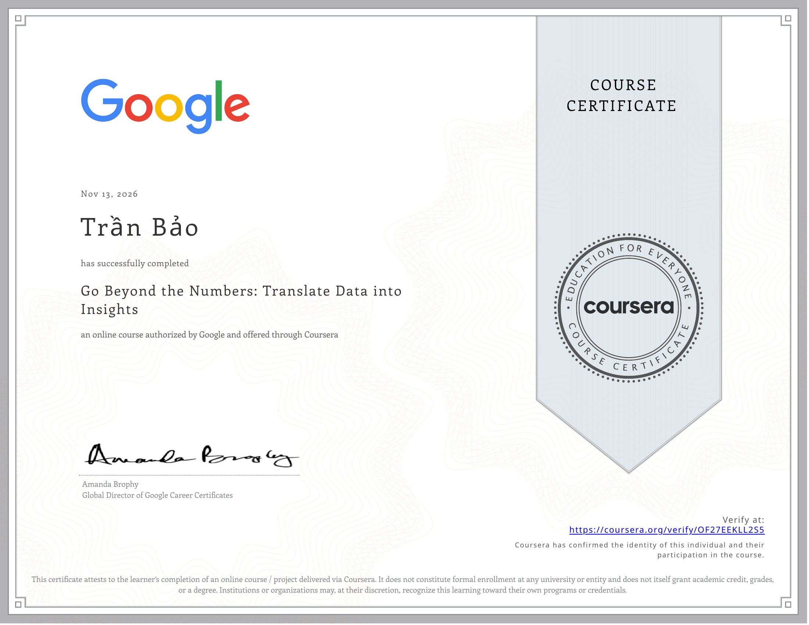
    </td>
  </tr>
  <tr>
    <td align="center" width="50%" valign="top">
      <strong>The Power of Statistics</strong><br/>
      <sub><a href="https://coursera.org/verify/LHY16EIFUE4I">核验凭证</a></sub><br/><br/>
      
    </td>
    <td align="center" width="50%" valign="top">
      <strong>Regression Analysis: Simplify Complex Data Relationships</strong><br/>
      <sub><a href="https://coursera.org/verify/HK6S1UCOG5QL">核验凭证</a></sub><br/><br/>
      
    </td>
  </tr>
  <tr>
    <td align="center" width="50%" valign="top">
      <strong>The Nuts and Bolts of Machine Learning</strong><br/>
      <sub><a href="https://coursera.org/verify/B9RGCPT68Q8T">核验凭证</a></sub><br/><br/>
      
    </td>
    <td align="center" width="50%" valign="top">
      <strong>Google Advanced Data Analytics Capstone</strong><br/>
      <sub><a href="https://coursera.org/verify/170BWE2VIAPM">核验凭证</a></sub><br/><br/>
      
    </td>
  </tr>
  <tr>
    <td align="center" width="50%" valign="top">
      <strong>Accelerate Your Job Search with AI</strong><br/>
      <sub><a href="https://coursera.org/verify/GYOETDKLOOFO">核验凭证</a></sub><br/><br/>
      
    </td>
    <td align="center" width="50%" valign="top"></td>
  </tr>
</table>

</details>
</details>

<br/>

<details>
<summary>🎓 <strong>Google Business Intelligence Professional Certificate (Google 商业智能专业认证)</strong> &nbsp;(已完成)</summary>
<br/>

- **颁发机构:** Google via Coursera
- **签发日期:** 2026年11月13日
- **凭证核验:** [Verify Professional Certificate](https://coursera.org/verify/professional-cert/Q9ORJ0ZTRT74)
- **概览:** 专注于商业智能数据模型设计、数据管道、交互式仪表板开发及决策报告体系的 4 门专业认证。

<p align="center">
  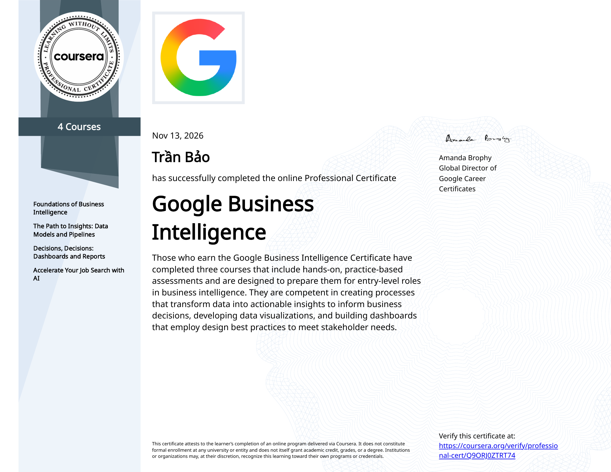
</p>

<details>
<summary>&nbsp;&nbsp;&nbsp;&nbsp;📚 <strong>查看 4 门课程结业证书</strong></summary>
<br/>

<table width="100%">
  <tr>
    <td align="center" width="50%" valign="top">
      <strong>Foundations of Business Intelligence</strong><br/>
      <sub><a href="https://coursera.org/verify/LT5YNQ53Q7O0">核验凭证</a></sub><br/><br/>
      
    </td>
    <td align="center" width="50%" valign="top">
      <strong>The Path to Insights: Data Models and Pipelines</strong><br/>
      <sub><a href="https://coursera.org/verify/235QUNKD0RI2">核验凭证</a></sub><br/><br/>
      
    </td>
  </tr>
  <tr>
    <td align="center" width="50%" valign="top">
      <strong>Decisions, Decisions: Dashboards and Reports</strong><br/>
      <sub><a href="https://coursera.org/verify/G2M8CT3DQ1H5">核验凭证</a></sub><br/><br/>
      
    </td>
    <td align="center" width="50%" valign="top">
      <strong>Accelerate Your Job Search with AI</strong><br/>
      <sub><a href="https://coursera.org/verify/GYOETDKLOOFO">核验凭证</a></sub><br/><br/>
      
    </td>
  </tr>
</table>

</details>
</details>

<br/>

<details>
<summary>🎓 <strong>Google Data Analysis with Python Specialization (Google Python 数据分析专项认证)</strong> &nbsp;(已完成)</summary>
<br/>

- **颁发机构:** Google via Coursera
- **签发日期:** 2026年11月12日
- **凭证核验:** [Verify Specialization](https://coursera.org/verify/specialization/NFRV9P8OER0U)
- **概览:** 涵盖 Python 编程基础、数据结构、NumPy、pandas、Jupyter Notebooks、探索性数据分析与数据清洗的 6 门专项认证。

<p align="center">
  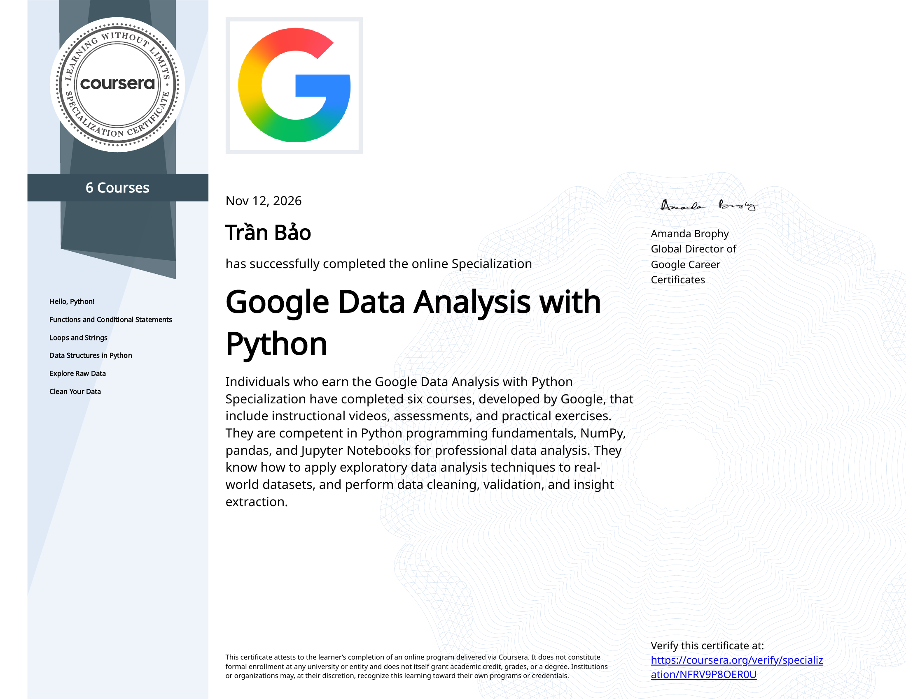
</p>

<details>
<summary>&nbsp;&nbsp;&nbsp;&nbsp;📚 <strong>查看 6 门课程结业证书</strong></summary>
<br/>

<table width="100%">
  <tr>
    <td align="center" width="50%" valign="top">
      <strong>Hello, Python!</strong><br/>
      <sub><a href="https://coursera.org/verify/3DNY4Y9JTZP1">核验凭证</a></sub><br/><br/>
      
    </td>
    <td align="center" width="50%" valign="top">
      <strong>Functions and Conditional Statements</strong><br/>
      <sub><a href="https://coursera.org/verify/8JAYGLXF8DOU">核验凭证</a></sub><br/><br/>
      
    </td>
  </tr>
  <tr>
    <td align="center" width="50%" valign="top">
      <strong>Loops and Strings</strong><br/>
      <sub><a href="https://coursera.org/verify/5EQ0YG720ZMB">核验凭证</a></sub><br/><br/>
      
    </td>
    <td align="center" width="50%" valign="top">
      <strong>Data Structures in Python</strong><br/>
      <sub><a href="https://coursera.org/verify/1AHU2UQNAN46">核验凭证</a></sub><br/><br/>
      
    </td>
  </tr>
  <tr>
    <td align="center" width="50%" valign="top">
      <strong>Explore Raw Data</strong><br/>
      <sub><a href="https://coursera.org/verify/O3S58IAOEIGS">核验凭证</a></sub><br/><br/>
      
    </td>
    <td align="center" width="50%" valign="top">
      <strong>Clean Your Data</strong><br/>
      <sub><a href="https://coursera.org/verify/8679HN59YFAN">核验凭证</a></sub><br/><br/>
      
    </td>
  </tr>
</table>

</details>
</details>

<br/>

<details>
<summary>🎓 <strong>Google Data-Driven Decision Making Specialization (Google 数据驱动决策专项认证)</strong> &nbsp;(已完成)</summary>
<br/>

- **颁发机构:** Google via Coursera
- **签发日期:** 2026年11月13日
- **凭证核验:** [Verify Specialization](https://coursera.org/verify/specialization/1ZP1AMMLFOYU)
- **概览:** 涵盖分析思维、数据伦理与完整性、数据可视化、汇报演示文稿及 AI 加速洞察的 9 门专项认证。

<p align="center">
  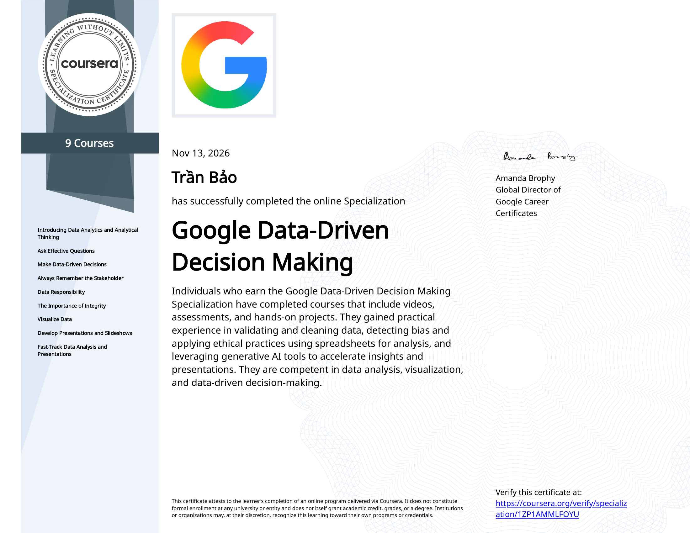
</p>

<details>
<summary>&nbsp;&nbsp;&nbsp;&nbsp;📚 <strong>查看 9 门课程结业证书</strong></summary>
<br/>

<table width="100%">
  <tr>
    <td align="center" width="50%" valign="top">
      <strong>Introducing Data Analytics and Analytical Thinking</strong><br/>
      <sub><a href="https://coursera.org/verify/C1TOCJH3327J">核验凭证</a></sub><br/><br/>
      
    </td>
    <td align="center" width="50%" valign="top">
      <strong>Ask Effective Questions</strong><br/>
      <sub><a href="https://coursera.org/verify/6DHLK4915HYF">核验凭证</a></sub><br/><br/>
      
    </td>
  </tr>
  <tr>
    <td align="center" width="50%" valign="top">
      <strong>Always Remember the Stakeholder</strong><br/>
      <sub><a href="https://coursera.org/verify/N757AML2RJJE">核验凭证</a></sub><br/><br/>
      
    </td>
    <td align="center" width="50%" valign="top">
      <strong>Make Data-Driven Decisions</strong><br/>
      <sub><a href="https://coursera.org/verify/PNIUAXGKK0MF">核验凭证</a></sub><br/><br/>
      
    </td>
  </tr>
  <tr>
    <td align="center" width="50%" valign="top">
      <strong>Data Responsibility</strong><br/>
      <sub><a href="https://coursera.org/verify/LF8NLGVN6O3C">核验凭证</a></sub><br/><br/>
      
    </td>
    <td align="center" width="50%" valign="top">
      <strong>The Importance of Integrity</strong><br/>
      <sub><a href="https://coursera.org/verify/BNN7AE4BYROR">核验凭证</a></sub><br/><br/>
      
    </td>
  </tr>
  <tr>
    <td align="center" width="50%" valign="top">
      <strong>Visualize Data</strong><br/>
      <sub><a href="https://coursera.org/verify/BOHFKPUPZR8J">核验凭证</a></sub><br/><br/>
      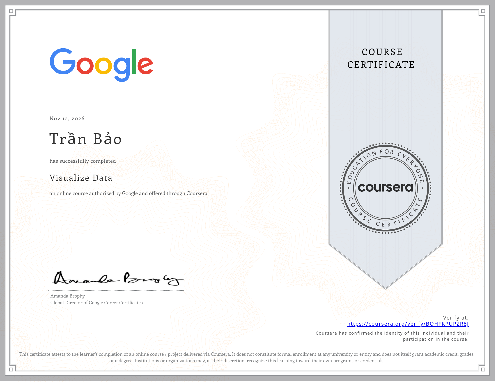
    </td>
    <td align="center" width="50%" valign="top">
      <strong>Develop Presentations and Slideshows</strong><br/>
      <sub><a href="https://coursera.org/verify/EEUHHM4ZCQTO">核验凭证</a></sub><br/><br/>
      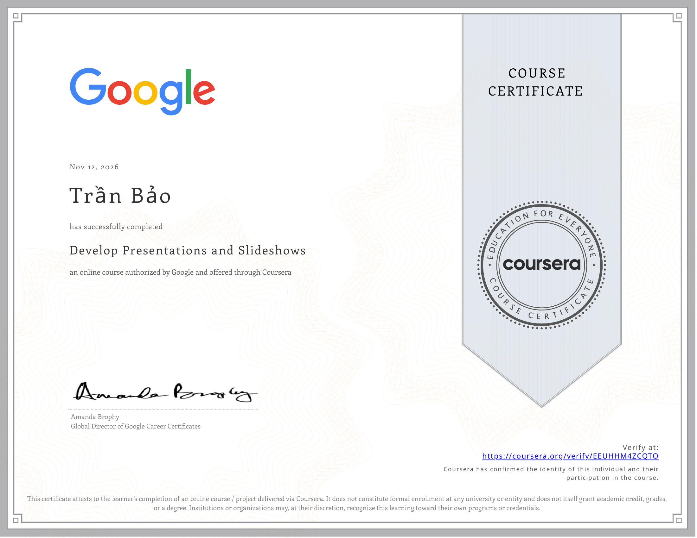
    </td>
  </tr>
  <tr>
    <td align="center" width="50%" valign="top">
      <strong>Fast-Track Data Analysis and Presentations</strong><br/>
      <sub><a href="https://coursera.org/verify/E257U5RBOKMF">核验凭证</a></sub><br/><br/>
      
    </td>
    <td align="center" width="50%" valign="top"></td>
  </tr>
</table>

</details>
</details>

<br/>

<details>
<summary>🎓 <strong>Google Cybersecurity Professional Certificate (Google 网络安全专业认证)</strong> &nbsp;(已完成)</summary>
<br/>

- **颁发机构:** Google via Coursera
- **签发日期:** 2026年11月13日
- **凭证核验:** [Verify Professional Certificate](https://coursera.org/verify/professional-cert/9UWJUFNXMGU7)
- **概览:** 涵盖风险管理、网络安全、Linux、SQL、SIEM 工具、入侵检测系统 (IDS) 及 Python 安全自动化的 9 门网络安全专业认证。

<p align="center">
  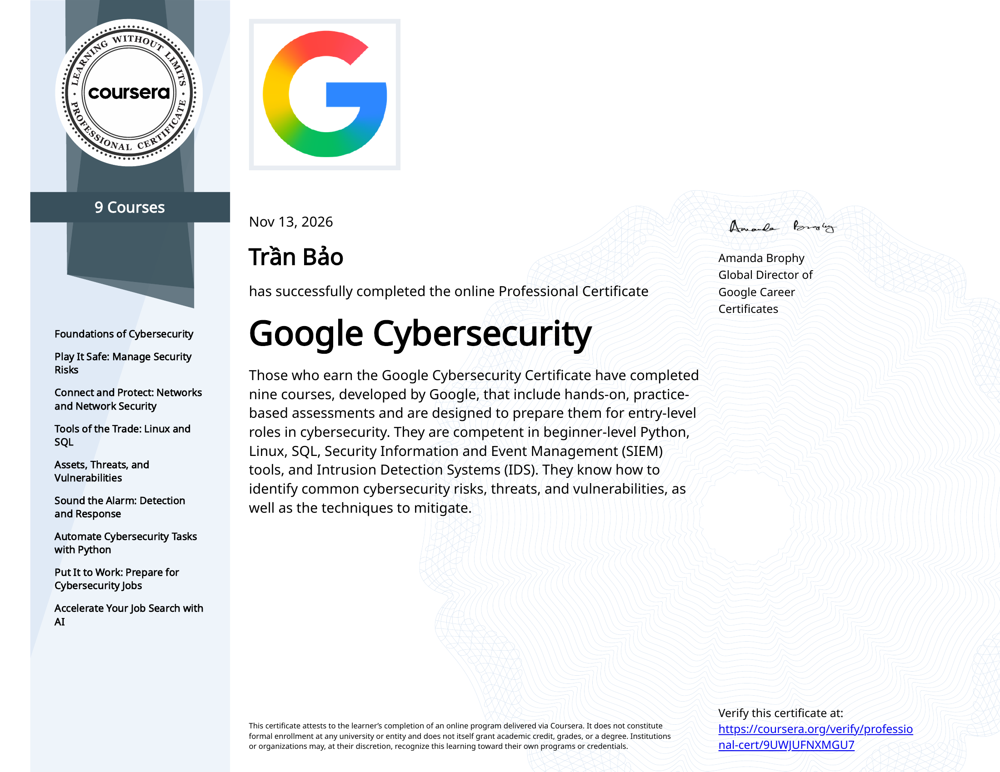
</p>

<details>
<summary>&nbsp;&nbsp;&nbsp;&nbsp;📚 <strong>查看 9 门课程结业证书</strong></summary>
<br/>

<table width="100%">
  <tr>
    <td align="center" width="50%" valign="top">
      <strong>Foundations of Cybersecurity</strong><br/>
      <sub><a href="https://coursera.org/verify/T20K6XVS4RTA">核验凭证</a></sub><br/><br/>
      
    </td>
    <td align="center" width="50%" valign="top">
      <strong>Play It Safe: Manage Security Risks</strong><br/>
      <sub><a href="https://coursera.org/verify/00NXOKH3F7CD">核验凭证</a></sub><br/><br/>
      
    </td>
  </tr>
  <tr>
    <td align="center" width="50%" valign="top">
      <strong>Connect and Protect: Networks and Network Security</strong><br/>
      <sub><a href="https://coursera.org/verify/U7PWCSLN5BXO">核验凭证</a></sub><br/><br/>
      
    </td>
    <td align="center" width="50%" valign="top">
      <strong>Tools of the Trade: Linux and SQL</strong><br/>
      <sub><a href="https://coursera.org/verify/NSAMFIBNIZ1U">核验凭证</a></sub><br/><br/>
      
    </td>
  </tr>
  <tr>
    <td align="center" width="50%" valign="top">
      <strong>Assets, Threats, and Vulnerabilities</strong><br/>
      <sub><a href="https://coursera.org/verify/XBSV56N8R8ZW">核验凭证</a></sub><br/><br/>
      
    </td>
    <td align="center" width="50%" valign="top">
      <strong>Sound the Alarm: Detection and Response</strong><br/>
      <sub><a href="https://coursera.org/verify/H8EJUBDCNK8D">核验凭证</a></sub><br/><br/>
      
    </td>
  </tr>
  <tr>
    <td align="center" width="50%" valign="top">
      <strong>Automate Cybersecurity Tasks with Python</strong><br/>
      <sub><a href="https://coursera.org/verify/73SYSHCXLCKT">核验凭证</a></sub><br/><br/>
      
    </td>
    <td align="center" width="50%" valign="top">
      <strong>Put It to Work: Prepare for Cybersecurity Jobs</strong><br/>
      <sub><a href="https://coursera.org/verify/BZD82F5FTIS8">核验凭证</a></sub><br/><br/>
      
    </td>
  </tr>
  <tr>
    <td align="center" width="50%" valign="top">
      <strong>Accelerate Your Job Search with AI</strong><br/>
      <sub><a href="https://coursera.org/verify/GYOETDKLOOFO">核验凭证</a></sub><br/><br/>
      
    </td>
    <td align="center" width="50%" valign="top"></td>
  </tr>
</table>

</details>
</details>

<br/>

<details>
<summary>🎓 <strong>Google IT Support Professional Certificate (Google IT 支持专业认证)</strong> &nbsp;(已完成)</summary>
<br/>

- **颁发机构:** Google via Coursera
- **签发日期:** 2026年11月13日
- **凭证核验:** [Verify Professional Certificate](https://coursera.org/verify/professional-cert/AZWBFV4V1UKM)
- **概览:** 涵盖故障排查、计算机网络、操作系统、系统管理、IT 基础设施服务及信息安全的 6 门 IT 支持专业认证。

<p align="center">
  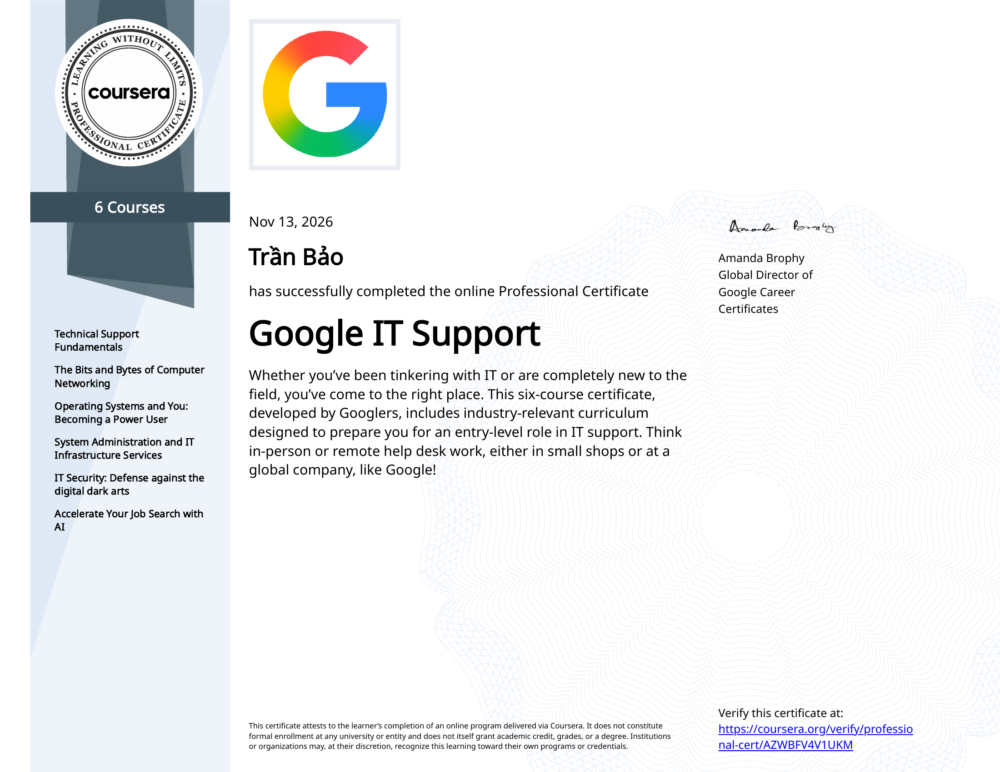
</p>

<details>
<summary>&nbsp;&nbsp;&nbsp;&nbsp;📚 <strong>查看 6 门课程结业证书</strong></summary>
<br/>

<table width="100%">
  <tr>
    <td align="center" width="50%" valign="top">
      <strong>Technical Support Fundamentals</strong><br/>
      <sub><a href="https://coursera.org/verify/NS73Z7UUYSL7">核验凭证</a></sub><br/><br/>
      
    </td>
    <td align="center" width="50%" valign="top">
      <strong>The Bits and Bytes of Computer Networking</strong><br/>
      <sub><a href="https://coursera.org/verify/6WPUDS6S49RO">核验凭证</a></sub><br/><br/>
      
    </td>
  </tr>
  <tr>
    <td align="center" width="50%" valign="top">
      <strong>Operating Systems and You: Becoming a Power User</strong><br/>
      <sub><a href="https://coursera.org/verify/4V0XKDPRP8I7">核验凭证</a></sub><br/><br/>
      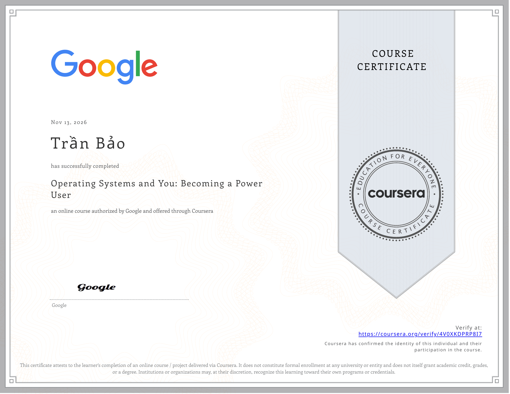
    </td>
    <td align="center" width="50%" valign="top">
      <strong>System Administration and IT Infrastructure Services</strong><br/>
      <sub><a href="https://coursera.org/verify/W12CAJJ5PSM2">核验凭证</a></sub><br/><br/>
      
    </td>
  </tr>
  <tr>
    <td align="center" width="50%" valign="top">
      <strong>IT Security: Defense against the digital dark arts</strong><br/>
      <sub><a href="https://coursera.org/verify/HXKKN1QXETVK">核验凭证</a></sub><br/><br/>
      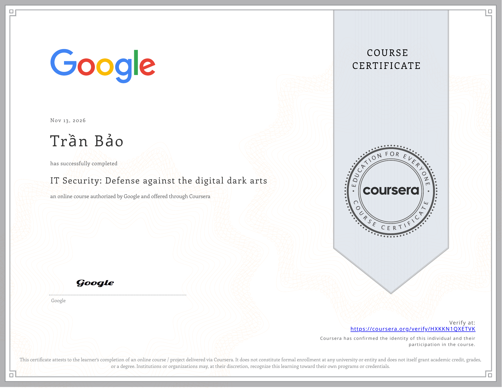
    </td>
    <td align="center" width="50%" valign="top">
      <strong>Accelerate Your Job Search with AI</strong><br/>
      <sub><a href="https://coursera.org/verify/GYOETDKLOOFO">核验凭证</a></sub><br/><br/>
      
    </td>
  </tr>
</table>

</details>
</details>

<br/>

<details>
<summary>🎓 <strong>Google IT Automation with Python Professional Certificate (Google Python IT 自动化专业认证)</strong> &nbsp;(已完成)</summary>
<br/>

- **颁发机构:** Google via Coursera
- **签发日期:** 2026年11月13日
- **凭证核验:** [Verify Professional Certificate](https://coursera.org/verify/professional-cert/05WZME20WSVU)
- **概览:** 专注于 Python 脚本、操作系统交互、Git 与 GitHub、故障调试、云配置管理及 IT 任务自动化的 7 门专业认证。

<p align="center">
  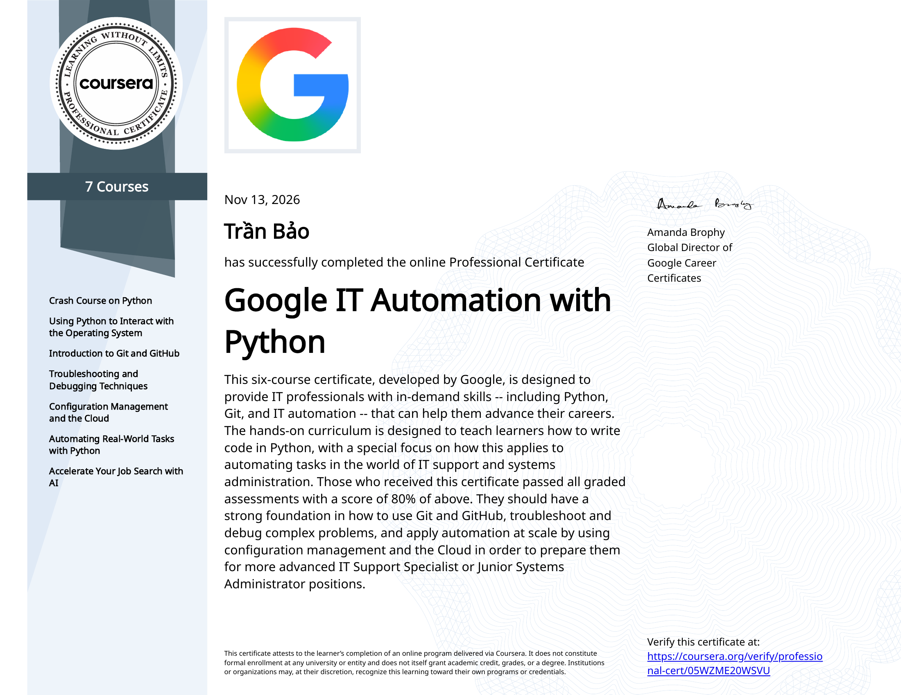
</p>

<details>
<summary>&nbsp;&nbsp;&nbsp;&nbsp;📚 <strong>查看 7 门课程结业证书</strong></summary>
<br/>

<table width="100%">
  <tr>
    <td align="center" width="50%" valign="top">
      <strong>Crash Course on Python</strong><br/>
      <sub><a href="https://coursera.org/verify/BSE4U0H8B08N">核验凭证</a></sub><br/><br/>
      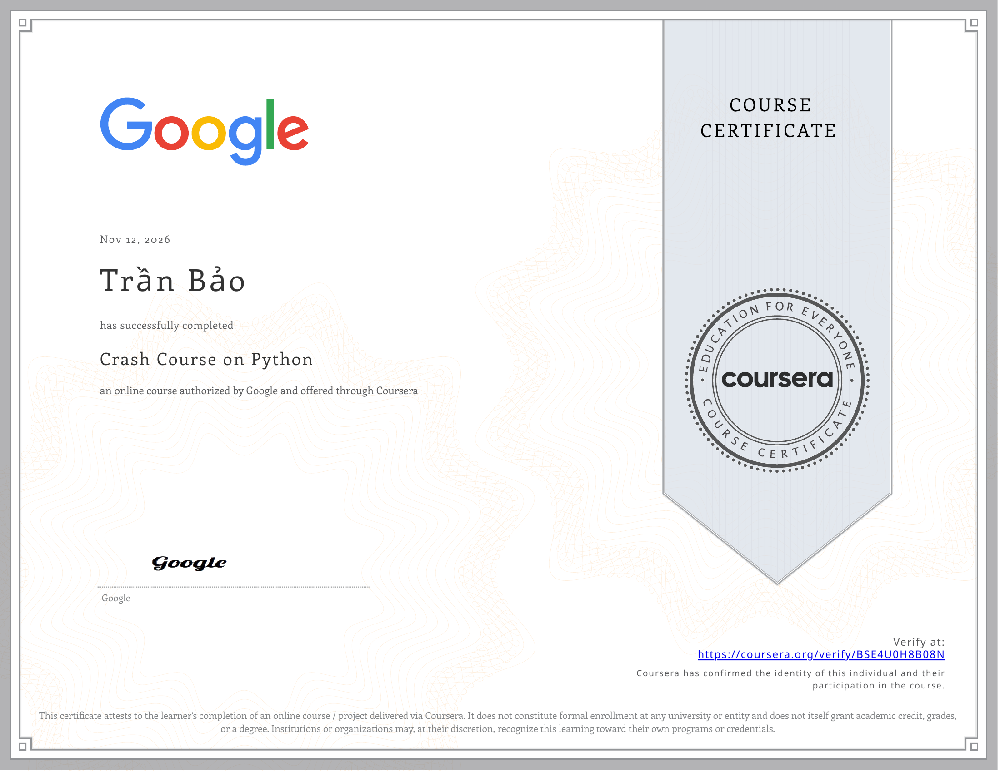
    </td>
    <td align="center" width="50%" valign="top">
      <strong>Using Python to Interact with the Operating System</strong><br/>
      <sub><a href="https://coursera.org/verify/5UVGEH5K5Z3F">核验凭证</a></sub><br/><br/>
      
    </td>
  </tr>
  <tr>
    <td align="center" width="50%" valign="top">
      <strong>Introduction to Git and GitHub</strong><br/>
      <sub><a href="https://coursera.org/verify/5UE3UDE7FKDN">核验凭证</a></sub><br/><br/>
      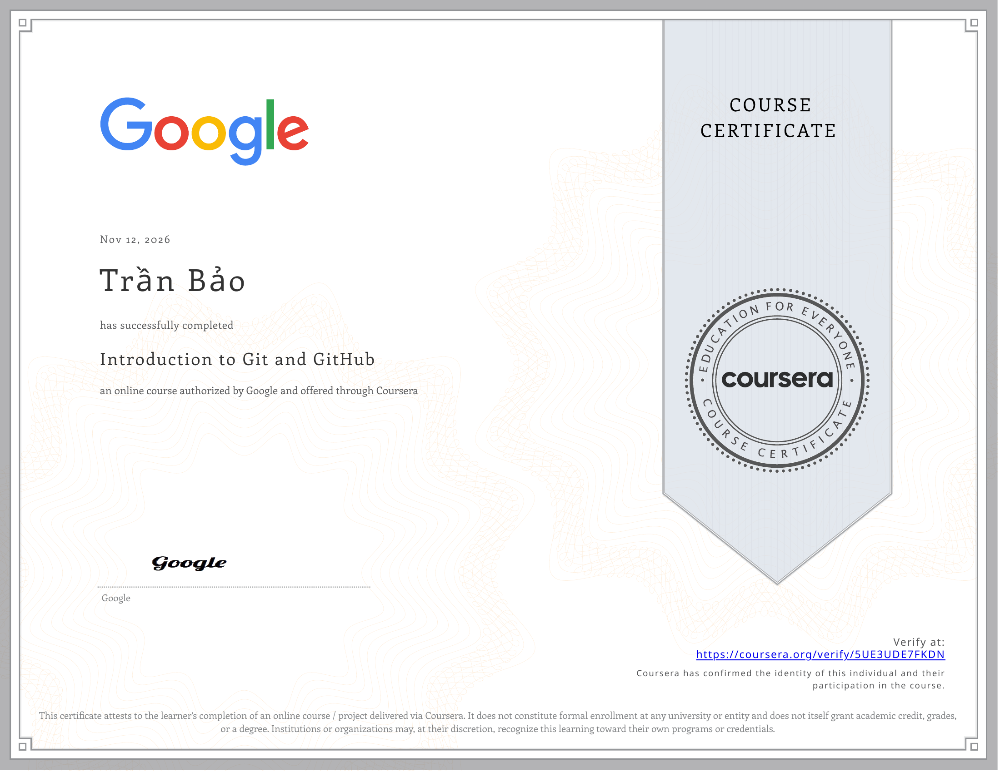
    </td>
    <td align="center" width="50%" valign="top">
      <strong>Troubleshooting and Debugging Techniques</strong><br/>
      <sub><a href="https://coursera.org/verify/UJFKU38NWFDC">核验凭证</a></sub><br/><br/>
      
    </td>
  </tr>
  <tr>
    <td align="center" width="50%" valign="top">
      <strong>Configuration Management and the Cloud</strong><br/>
      <sub><a href="https://coursera.org/verify/4GSZ3MGDETBC">核验凭证</a></sub><br/><br/>
      
    </td>
    <td align="center" width="50%" valign="top">
      <strong>Automating Real-World Tasks with Python</strong><br/>
      <sub><a href="https://coursera.org/verify/EGF3IM66WIPT">核验凭证</a></sub><br/><br/>
      
    </td>
  </tr>
  <tr>
    <td align="center" width="50%" valign="top">
      <strong>Accelerate Your Job Search with AI</strong><br/>
      <sub><a href="https://coursera.org/verify/GYOETDKLOOFO">核验凭证</a></sub><br/><br/>
      
    </td>
    <td align="center" width="50%" valign="top"></td>
  </tr>
</table>

</details>
</details>

<br/>

<details>
<summary>🎓 <strong>Google Project Management Professional Certificate (Google 项目管理专业认证)</strong> &nbsp;(已完成)</summary>
<br/>

- **颁发机构:** Google via Coursera
- **签发日期:** 2026年11月13日
- **凭证核验:** [Verify Professional Certificate](https://coursera.org/verify/professional-cert/NH44VV78F2B7)
- **概览:** 涵盖项目启动、规划、执行、风险管理、敏捷方法论及实战毕业项目的 7 门项目管理专业认证。

<p align="center">
  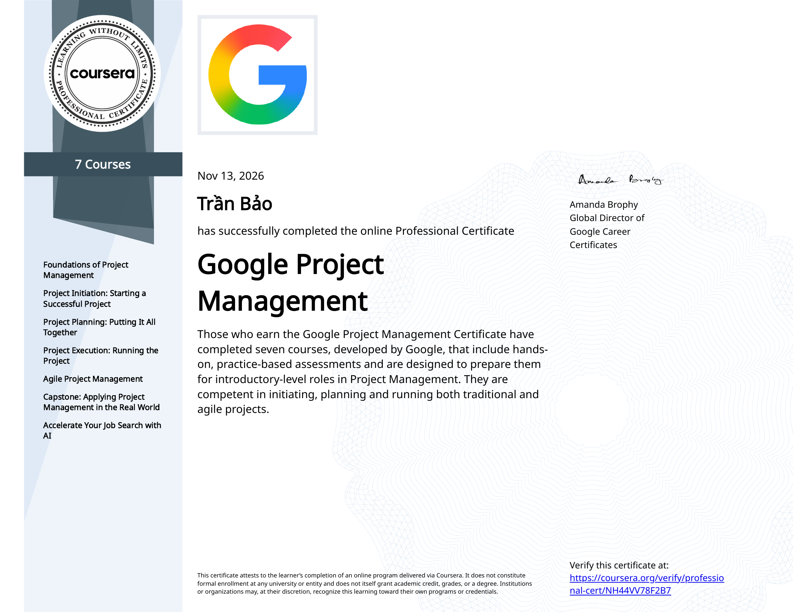
</p>

<details>
<summary>&nbsp;&nbsp;&nbsp;&nbsp;📚 <strong>查看 7 门课程结业证书</strong></summary>
<br/>

<table width="100%">
  <tr>
    <td align="center" width="50%" valign="top">
      <strong>Foundations of Project Management</strong><br/>
      <sub><a href="https://coursera.org/verify/XLZG1AYONQ02">核验凭证</a></sub><br/><br/>
      
    </td>
    <td align="center" width="50%" valign="top">
      <strong>Project Initiation: Starting a Successful Project</strong><br/>
      <sub><a href="https://coursera.org/verify/JQ4MPIXANBL3">核验凭证</a></sub><br/><br/>
      
    </td>
  </tr>
  <tr>
    <td align="center" width="50%" valign="top">
      <strong>Project Planning: Putting It All Together</strong><br/>
      <sub><a href="https://coursera.org/verify/II6AXM71ULSV">核验凭证</a></sub><br/><br/>
      
    </td>
    <td align="center" width="50%" valign="top">
      <strong>Project Execution: Running the Project</strong><br/>
      <sub><a href="https://coursera.org/verify/VYXQ7AO6CAZB">核验凭证</a></sub><br/><br/>
      
    </td>
  </tr>
  <tr>
    <td align="center" width="50%" valign="top">
      <strong>Agile Project Management</strong><br/>
      <sub><a href="https://coursera.org/verify/P178HOLJMROW">核验凭证</a></sub><br/><br/>
      
    </td>
    <td align="center" width="50%" valign="top">
      <strong>Capstone: Applying Project Management in the Real World</strong><br/>
      <sub><a href="https://coursera.org/verify/SYU3CFLD0SUA">核验凭证</a></sub><br/><br/>
      
    </td>
  </tr>
  <tr>
    <td align="center" width="50%" valign="top">
      <strong>Accelerate Your Job Search with AI</strong><br/>
      <sub><a href="https://coursera.org/verify/GYOETDKLOOFO">核验凭证</a></sub><br/><br/>
      
    </td>
    <td align="center" width="50%" valign="top"></td>
  </tr>
</table>

</details>
</details>

<br/>

<details>
<summary>🎓 <strong>Google Agile Essentials Specialization (Google 敏捷核心专项认证)</strong> &nbsp;(已完成)</summary>
<br/>

- **颁发机构:** Google via Coursera
- **签发日期:** 2026年11月13日
- **凭证核验:** [Verify Specialization](https://coursera.org/verify/specialization/J85Z0EE86MU1)
- **概览:** 专注于敏捷方法论、Scrum 框架实施、待办事项管理、冲刺规划与团队效能度量的 3 门专项认证。

<p align="center">
  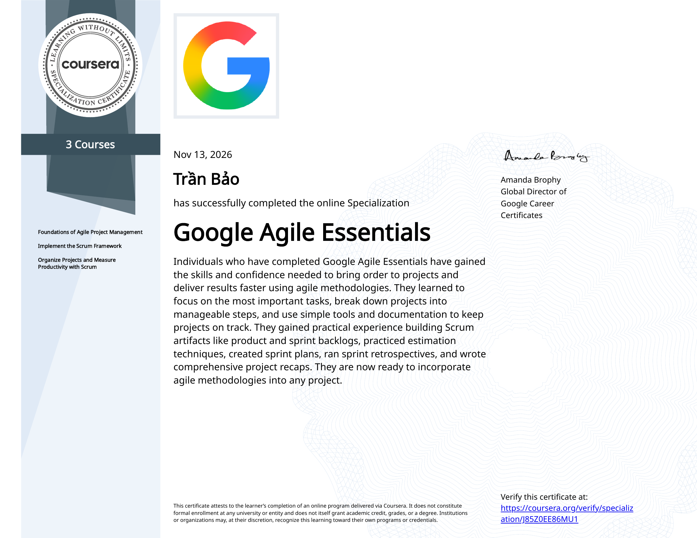
</p>

<details>
<summary>&nbsp;&nbsp;&nbsp;&nbsp;📚 <strong>查看 3 门课程结业证书</strong></summary>
<br/>

<table width="100%">
  <tr>
    <td align="center" width="50%" valign="top">
      <strong>Foundations of Agile Project Management</strong><br/>
      <sub><a href="https://coursera.org/verify/KOSPFIK9O8GK">核验凭证</a></sub><br/><br/>
      
    </td>
    <td align="center" width="50%" valign="top">
      <strong>Implement the Scrum Framework</strong><br/>
      <sub><a href="https://coursera.org/verify/VT8LX4X3NTVV">核验凭证</a></sub><br/><br/>
      
    </td>
  </tr>
  <tr>
    <td align="center" width="50%" valign="top">
      <strong>Organize Projects and Measure Productivity with Scrum</strong><br/>
      <sub><a href="https://coursera.org/verify/7C13SWNRD9DY">核验凭证</a></sub><br/><br/>
      
    </td>
    <td align="center" width="50%" valign="top"></td>
  </tr>
</table>

</details>
</details>

<br/>

<details>
<summary>🎓 <strong>Google Stakeholder Management Specialization (Google 利益相关者管理专项认证)</strong> &nbsp;(已完成)</summary>
<br/>

- **颁发机构:** Google via Coursera
- **签发日期:** 2026年11月12日
- **凭证核验:** [Verify Specialization](https://coursera.org/verify/specialization/VJOQ4SK8QFZZ)
- **概览:** 培养利益相关者分析、RACI 矩阵应用、沟通规划、文档组织与团队领导力的 3 门专项认证。

<p align="center">
  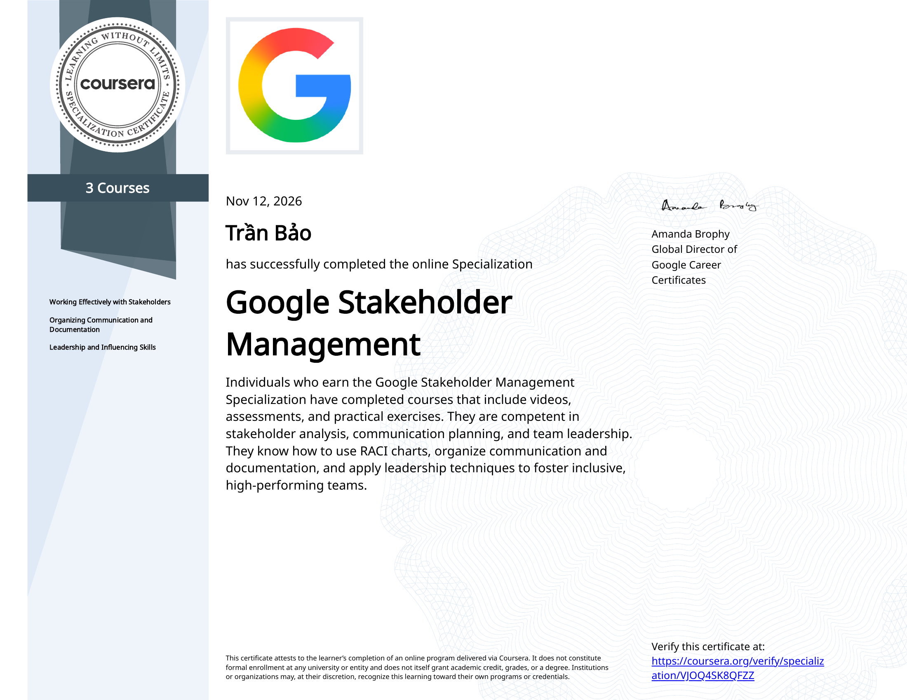
</p>

<details>
<summary>&nbsp;&nbsp;&nbsp;&nbsp;📚 <strong>查看 3 门课程结业证书</strong></summary>
<br/>

<table width="100%">
  <tr>
    <td align="center" width="50%" valign="top">
      <strong>Working Effectively with Stakeholders</strong><br/>
      <sub><a href="https://coursera.org/verify/KGYZFUR0778U">核验凭证</a></sub><br/><br/>
      
    </td>
    <td align="center" width="50%" valign="top">
      <strong>Organizing Communication and Documentation</strong><br/>
      <sub><a href="https://coursera.org/verify/OLB5OI3A5W8L">核验凭证</a></sub><br/><br/>
      
    </td>
  </tr>
  <tr>
    <td align="center" width="50%" valign="top">
      <strong>Leadership and Influencing Skills</strong><br/>
      <sub><a href="https://coursera.org/verify/S4SUQITP49MH">核验凭证</a></sub><br/><br/>
      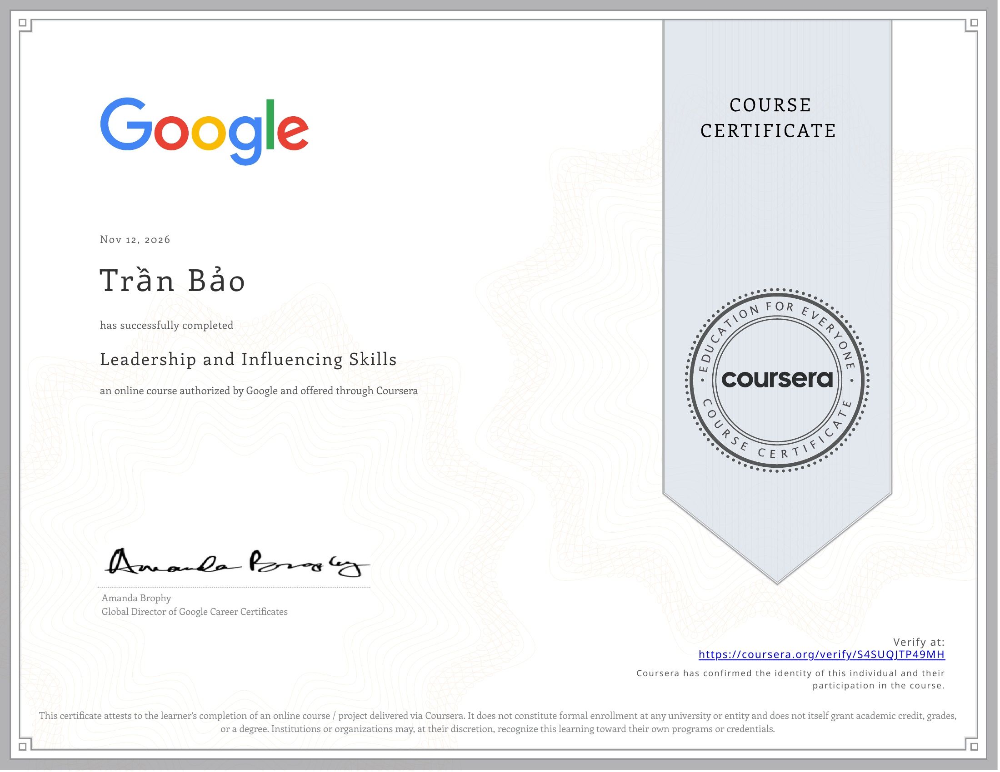
    </td>
    <td align="center" width="50%" valign="top"></td>
  </tr>
</table>

</details>
</details>

<br/>

<details>
<summary>🎓 <strong>Google Digital Marketing &amp; E-commerce Professional Certificate (Google 数字营销与电子商务专业认证)</strong> &nbsp;(已完成)</summary>
<br/>

- **颁发机构:** Google via Coursera
- **签发日期:** 2026年11月13日
- **凭证核验:** [Verify Professional Certificate](https://coursera.org/verify/professional-cert/ON4JLNE4NL81)
- **概览:** 涵盖数字营销策略、客户引流与互动、电子邮件营销、营销数据分析及电商平台运营的 8 门专业认证。

<p align="center">
  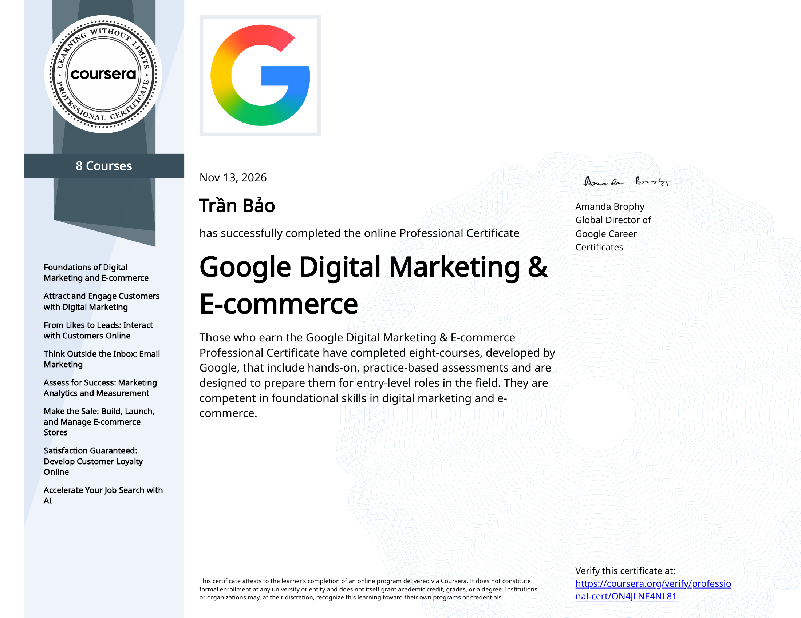
</p>

<details>
<summary>&nbsp;&nbsp;&nbsp;&nbsp;📚 <strong>查看 8 门课程结业证书</strong></summary>
<br/>

<table width="100%">
  <tr>
    <td align="center" width="50%" valign="top">
      <strong>Foundations of Digital Marketing and E-commerce</strong><br/>
      <sub><a href="https://coursera.org/verify/GA3FAX5PS766">核验凭证</a></sub><br/><br/>
      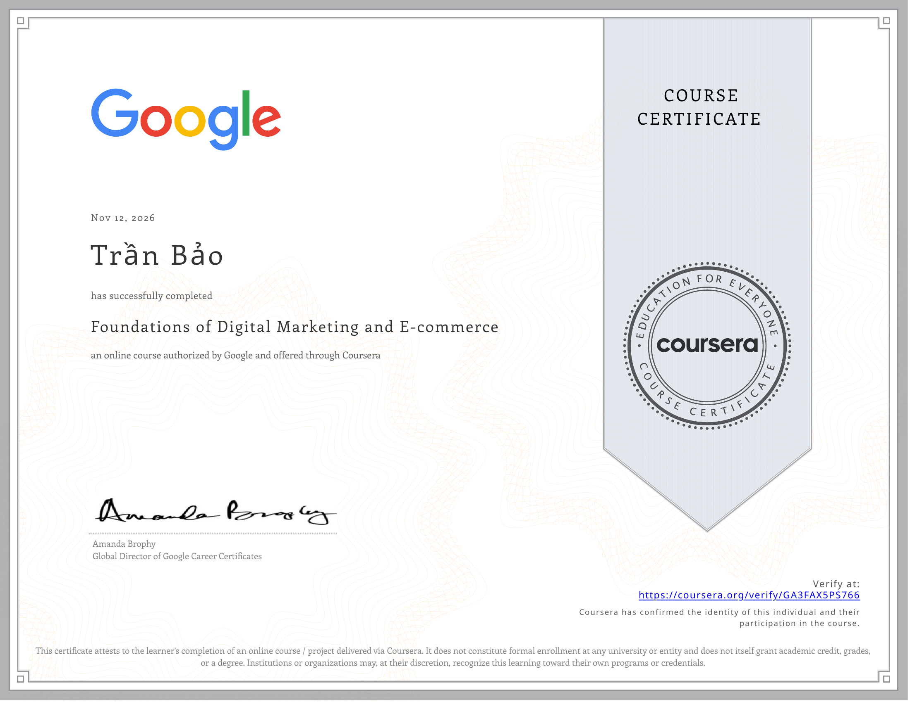
    </td>
    <td align="center" width="50%" valign="top">
      <strong>Attract and Engage Customers with Digital Marketing</strong><br/>
      <sub><a href="https://coursera.org/verify/4VTS7IZ4DOT3">核验凭证</a></sub><br/><br/>
      
    </td>
  </tr>
  <tr>
    <td align="center" width="50%" valign="top">
      <strong>From Likes to Leads: Interact with Customers Online</strong><br/>
      <sub><a href="https://coursera.org/verify/08NANXFK393K">核验凭证</a></sub><br/><br/>
      
    </td>
    <td align="center" width="50%" valign="top">
      <strong>Think Outside the Inbox: Email Marketing</strong><br/>
      <sub><a href="https://coursera.org/verify/N9FNHEF30VSP">核验凭证</a></sub><br/><br/>
      
    </td>
  </tr>
  <tr>
    <td align="center" width="50%" valign="top">
      <strong>Assess for Success: Marketing Analytics and Measurement</strong><br/>
      <sub><a href="https://coursera.org/verify/B1ULZ0UKB0RV">核验凭证</a></sub><br/><br/>
      
    </td>
    <td align="center" width="50%" valign="top">
      <strong>Make the Sale: Build, Launch, and Manage E-commerce Stores</strong><br/>
      <sub><a href="https://coursera.org/verify/RSFWM3XJHZ9Z">核验凭证</a></sub><br/><br/>
      
    </td>
  </tr>
  <tr>
    <td align="center" width="50%" valign="top">
      <strong>Satisfaction Guaranteed: Develop Customer Loyalty Online</strong><br/>
      <sub><a href="https://coursera.org/verify/R7MZYGL6HZTT">核验凭证</a></sub><br/><br/>
      
    </td>
    <td align="center" width="50%" valign="top">
      <strong>Accelerate Your Job Search with AI</strong><br/>
      <sub><a href="https://coursera.org/verify/GYOETDKLOOFO">核验凭证</a></sub><br/><br/>
      
    </td>
  </tr>
</table>

</details>
</details>

<br/>

<details>
<summary>🎓 <strong>其他 Google 专项课程结业证书</strong> &nbsp;(已完成)</summary>
<br/>

- **颁发机构:** Google via Coursera
- **签发日期:** 2026年11月12日–13日
- **概览:** 来自 Google（Coursera）的 12 门补充专项课程结业证书，涵盖网络架构与安全加固、社交媒体与电商运营以及团队领导力。

<details>
<summary>&nbsp;&nbsp;&nbsp;&nbsp;📚 <strong>查看 12 门课程结业证书</strong></summary>
<br/>

<table width="100%">
  <tr>
    <td align="center" width="50%" valign="top">
      <strong>Network Architecture</strong><br/>
      <sub><a href="https://coursera.org/verify/BO9VN4Z89YZT">核验凭证</a></sub><br/><br/>
      
    </td>
    <td align="center" width="50%" valign="top">
      <strong>Network Operations</strong><br/>
      <sub><a href="https://coursera.org/verify/5UUFTWV9T3LN">核验凭证</a></sub><br/><br/>
      
    </td>
  </tr>
  <tr>
    <td align="center" width="50%" valign="top">
      <strong>Introduction to Detection and Incident Response</strong><br/>
      <sub><a href="https://coursera.org/verify/BO62CEZR8IFO">核验凭证</a></sub><br/><br/>
      
    </td>
    <td align="center" width="50%" valign="top">
      <strong>Secure Against Network Intrusions</strong><br/>
      <sub><a href="https://coursera.org/verify/H1O2YCAAIIPK">核验凭证</a></sub><br/><br/>
      
    </td>
  </tr>
  <tr>
    <td align="center" width="50%" valign="top">
      <strong>Security Hardening</strong><br/>
      <sub><a href="https://coursera.org/verify/HQMJGXCGRK6C">核验凭证</a></sub><br/><br/>
      
    </td>
    <td align="center" width="50%" valign="top">
      <strong>Capture and Captivate Your Audience</strong><br/>
      <sub><a href="https://coursera.org/verify/MSFZAV1XCWP1">核验凭证</a></sub><br/><br/>
      
    </td>
  </tr>
  <tr>
    <td align="center" width="50%" valign="top">
      <strong>Listening and Engagement on Social Media</strong><br/>
      <sub><a href="https://coursera.org/verify/POC41WBJB50E">核验凭证</a></sub><br/><br/>
      
    </td>
    <td align="center" width="50%" valign="top">
      <strong>Transform Engagement into Customers</strong><br/>
      <sub><a href="https://coursera.org/verify/5TCGLGM2MWSO">核验凭证</a></sub><br/><br/>
      
    </td>
  </tr>
  <tr>
    <td align="center" width="50%" valign="top">
      <strong>Engage Customers With an Online Store</strong><br/>
      <sub><a href="https://coursera.org/verify/O5SB42AX36DE">核验凭证</a></sub><br/><br/>
      
    </td>
    <td align="center" width="50%" valign="top">
      <strong>Create a High-Performing Team</strong><br/>
      <sub><a href="https://coursera.org/verify/ITAJ1UTVWLVQ">核验凭证</a></sub><br/><br/>
      
    </td>
  </tr>
  <tr>
    <td align="center" width="50%" valign="top">
      <strong>Set and Achieve Team Goals</strong><br/>
      <sub><a href="https://coursera.org/verify/XD1R5HT6ZT1N">核验凭证</a></sub><br/><br/>
      
    </td>
    <td align="center" width="50%" valign="top">
      <strong>Support Individual Growth and Development</strong><br/>
      <sub><a href="https://coursera.org/verify/KS58B2X0RCR1">核验凭证</a></sub><br/><br/>
      
    </td>
  </tr>
</table>

</details>
</details>

<br/>

<details>
<summary>🎓 <strong>AI Application for Game, Web, and Project Management (AI 场景应用实战)</strong></summary>
<br/>

- **主办机构:** 绿量子有限责任公司 (Công ty TNHH Lượng Từ Xanh)
- **实训周期:** 2026年2月4日 – 15日
- **培训地点:** 越南 胡志明市
- **概览:** 实战探究将前沿 AI 技术融入工业级软件架构、游戏系统及敏捷项目管理体系。

<p align="center">
  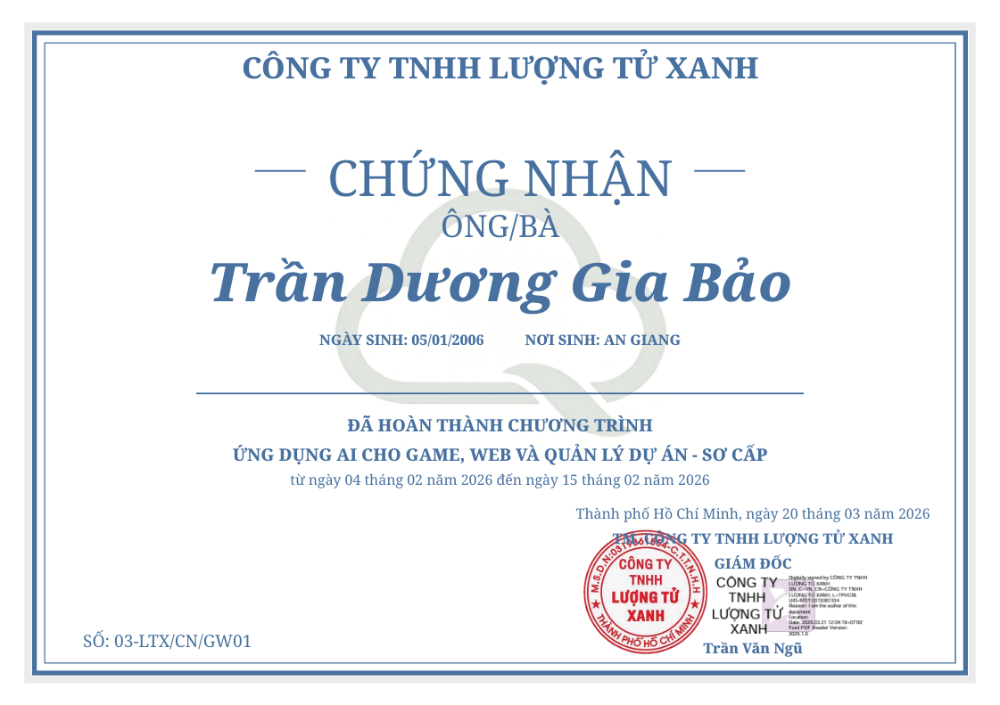
</p>
</details>

<br/>

<details>
<summary>🎓 <strong>Financial Data Analysis and Decision-Making in the Advent of AI (金融数据分析与决策)</strong></summary>
<br/>

- **状态:** 已结业
- **概览:** 基于 AI 工具的计算金融数据分析基石、统计指标推演与智能决策模型化应用。

<p align="center">
  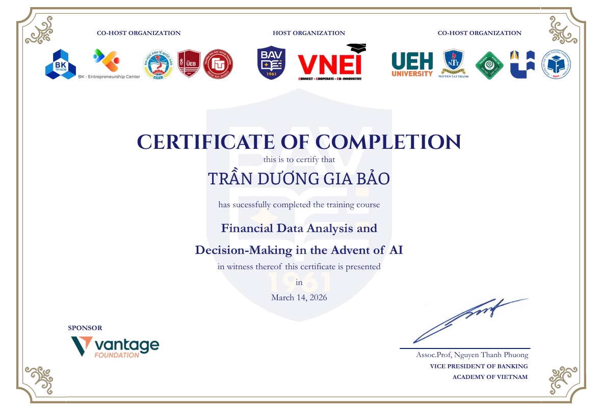
</p>
</details>

<br/>

<details>
<summary>🎓 <strong>Gemini Certified (Google 认证)</strong></summary>
<br/>

- **认证状态:** 已获得权威认证
- **概览:** 彰显在学术科研、知识整合、研究方法论与学习流程中熟练驾驭 Google Gemini 多模态模型的高阶能力。

<table width="100%">
  <tr>
    <td align="center" width="50%" valign="top">
      <strong>Gemini Certified Educator (认证教育导师)</strong><br/><br/>
      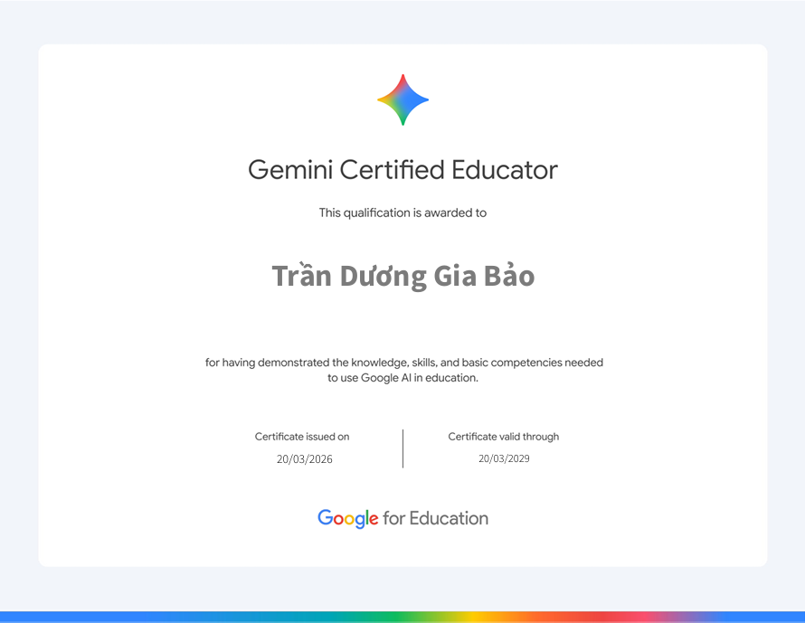
    </td>
    <td align="center" width="50%" valign="top">
      <strong>Gemini Certified University Student (认证大学生)</strong><br/><br/>
      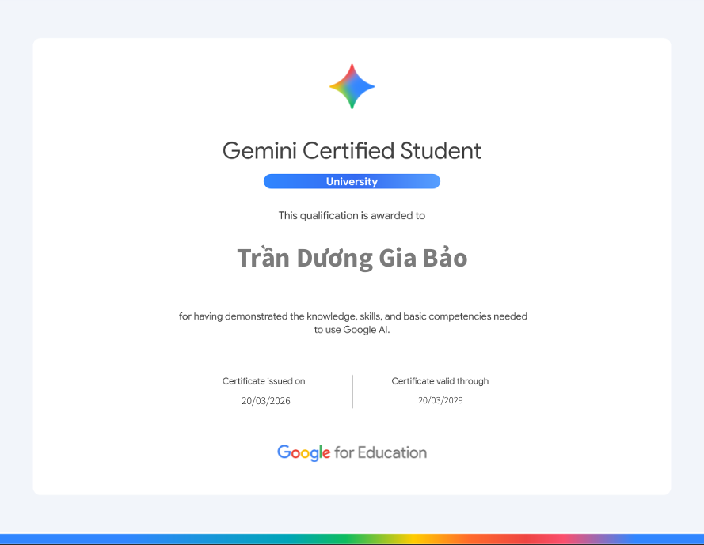
    </td>
  </tr>
</table>
</details>

---

### 📊 GitHub 数据统计

<div align="center">


&nbsp;


<br/><br/>


</div>

---

### 📬 保持联系

<div align="center">

<a href="mailto:tranduonggiabao0501email@gmail.com">
  
</a>
&nbsp;
<a href="https://peo051.github.io/portfolio/">
  
</a>
&nbsp;
<a href="https://www.linkedin.com/in/peo0501">
  
</a>
&nbsp;
<a href="https://github.com/Peo051">
  
</a>

</div>

<br/>

---

<div align="center">


<sub><i>"First, solve the problem. Then, write the code." — John Johnson</i></sub>

</div>
